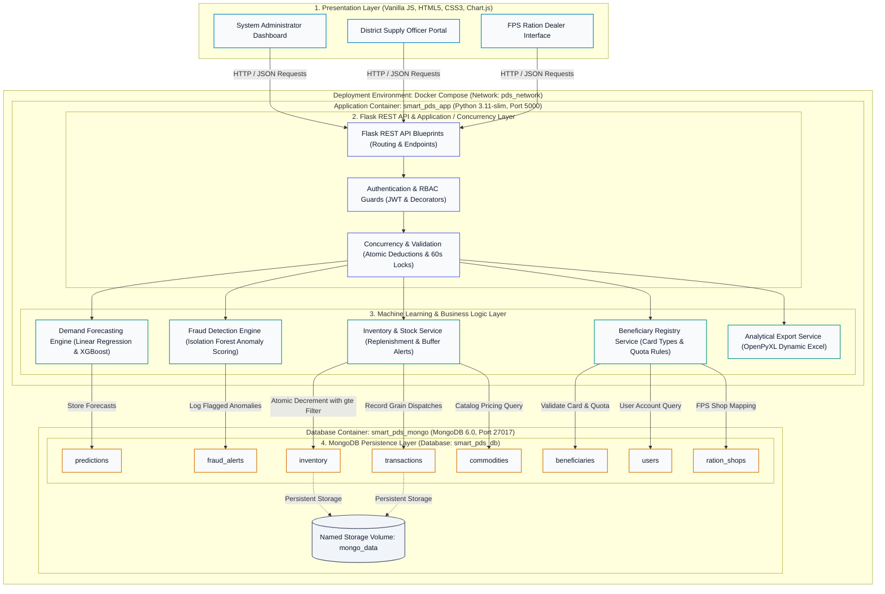
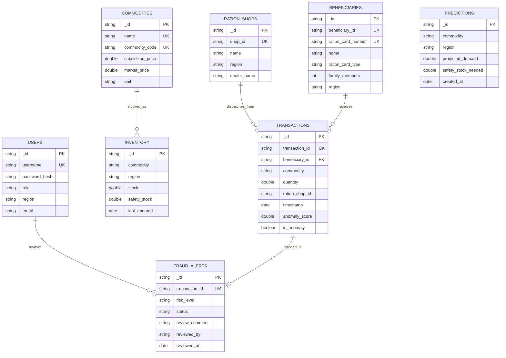

# AI-Powered Smart Public Distribution System (SmartPDS)

[](https://www.python.org/)
[](https://flask.palletsprojects.com/)
[](https://www.mongodb.com/)
[](https://scikit-learn.org/)
[](https://xgboost.readthedocs.io/)
[-brightgreen.svg)](https://pytest.org/)
[](https://www.docker.com/)

An enterprise predictive intelligence and transparent ration management platform designed for the Public Distribution System (PDS) under the Targeted Public Distribution System (TPDS) framework.

---

### Quick Start (Docker)

To deploy the entire stack (Flask backend and MongoDB 6.0) locally:

```bash
# 1. Clone the repository
git clone https://github.com/fawaz165/AI-Powered-Smart-PDS.git
cd AI-Powered-Smart-PDS

# 2. Configure environment settings
cp .env.example .env

# 3. Build and launch containers
docker compose up -d --build
```

- **Application URL**: [http://localhost:5000](http://localhost:5000)
- **Health Verification**: [http://localhost:5000/api/health](http://localhost:5000/api/health)
- **ML Engine Status**: [http://localhost:5000/api/ml-status](http://localhost:5000/api/ml-status)

---

## 1. Project Title

**AI-Powered Smart Public Distribution System (SmartPDS)**  
*Predictive Allocation Intelligence, Unsupervised Anomaly Detection & Transparent Ration Management*

---

## 2. Project Overview

The **AI-Powered Smart Public Distribution System (SmartPDS)** is a full-stack, data-driven web application developed to replace legacy static allocation and manual record-keeping across civil supplies networks. It couples machine learning demand forecasting with unsupervised transaction anomaly scoring, thread-safe inventory control, and role-governed operational interfaces.

The platform provides dedicated, role-tailored dashboards for:
1. **System Administrators**: Centralized configuration, catalog pricing, inventory adjustments, and fraud determination oversight.
2. **District Supply Officers**: Jurisdiction-wide allocation tracking, machine learning demand forecasting, and transaction review audits.
3. **Fair Price Shop (FPS) Dealers**: Counter distribution ledger entry, cardholder verification, and local shop inventory balance monitoring.

---

## 3. Problem Statement

Conventional food-grain distribution networks encounter recurring operational bottlenecks:

1. **Inaccurate Demand Allocation**: Static entitlement quotas fail to account for seasonal consumption shifts, festive demand surges, and demographic adjustments, resulting in regional grain shortages or excessive depot stockpiling.
2. **Leakage and Diversion**: Subsidized grain can be diverted away from eligible beneficiaries through bulk transactions and irregular distribution timings.
3. **Manual Verification Bottlenecks**: Auditing high-volume monthly transaction ledgers manually is operationally impractical, allowing suspicious distribution patterns to go unnoticed.
4. **Inventory Concurrency Vulnerabilities**: Without atomic conditional database updates, simultaneous draw requests across busy counters can cause race conditions and negative inventory balances.
5. **Fragmented Audit Reporting**: The absence of standardized, automated data export mechanisms complicates regulatory compliance and civil supplies oversight.

---

## 4. Project Objectives

- **Predictive Demand Estimation**: Provide monthly district- and commodity-level demand forecasts using regression models trained on demographic, seasonal, and historical indicators.
- **Unsupervised Anomaly Detection**: Identify behavioral anomalies in grain collection patterns using an Isolation Forest estimator without relying on ground-truth fraud labels.
- **Human-in-the-Loop Governance**: Provide an administrative review console where flagged statistical anomalies are evaluated by civil supplies officers before taking action, preventing automated denial of essential food grain.
- **Concurrency-Safe Inventory Operations**: Implement atomic database-level conditional decrements to guard against negative warehouse stock during simultaneous requests.
- **Role-Based Access Governance**: Enforce view and endpoint restrictions using JSON Web Tokens (JWT) and role-based access control (RBAC).
- **Automated Spreadsheet Analytics**: Generate structured Excel reports for stock tracking, distribution ledgers, and audit compliance.

---

## 5. Key Features

- **Multi-Model Demand Forecasting**: Benchmarks Linear Regression, Decision Tree, Random Forest, and XGBoost using month-grouped chronological validation.
- **Feature Ablation Transparency**: Evaluates demand prediction with and without statutory quotas to document target-derived feature influence and demographic predictive capability.
- **Behavioral Outlier Scoring**: Unsupervised Isolation Forest evaluates transaction quantity, quota ratios, inter-transaction intervals, and collection frequency.
- **Administrative Review Workflow**: Complete audit trail (`Pending Review` &rarr; `Verified Legitimate` or `Confirmed Irregularity`) with officer notes and timestamps.
- **Atomic Concurrency Protection**: Implements MongoDB `find_one_and_update` with `{"stock": {"$gte": requested_quantity}}` to prevent negative stock drawdowns.
- **Duplicate Submission Lock**: 60-second duplicate submission lock per cardholder and commodity to prevent accidental double-billing.
- **Role-Based Web Dashboards**: Dedicated UI views for System Administrators, District Supply Officers, and FPS Ration Dealers.
- **Automated Excel Export**: Formatted `.xlsx` generation using OpenPyXL with column styling, data filtering, and summary statistics.

---

## 6. System Architecture

The SmartPDS platform is designed across **four logical tiers**, deployed within an isolated **Docker Compose** container environment:



### Architectural Layer Breakdown

| Logical Tier | Responsibilities & Implemented Components | Codebase Location |
| :--- | :--- | :--- |
| **1. Presentation Layer** | Responsive web portals for Administrators, District Officers, and FPS Dealers. Client-side state handling and Chart.js telemetry. | `frontend/*.html`, `frontend/js/` |
| **2. Flask REST API & Concurrency Layer** | Blueprint HTTP routing, JWT token verification, RBAC route decorators, input schema validation, and atomic concurrency guards. | `backend/app.py`, `backend/routes/`, `backend/services/auth_service.py` |
| **3. Machine Learning & Business Logic Layer** | Demand regression estimators, Isolation Forest anomaly scoring, thread-safe inventory deduction, and OpenPyXL Excel compilation. | `backend/services/`, `backend/ml/` |
| **4. MongoDB Persistence Layer** | Eight indexed document collections managing operational data with atomic update operations. | `backend/database/mongo.py` |
| **Deployment Environment** | Multi-container Docker Compose orchestration (`smart_pds_app` and `smart_pds_mongo`) with persistent volume `mongo_data`. | `docker-compose.yml`, `Dockerfile` |

---

## 7. Technology Stack

All dependencies and versions are verified directly against `backend/requirements.txt`, `Dockerfile`, and `docker-compose.yml`:

| Component | Technology | Version | Purpose in Codebase |
| :--- | :--- | :--- | :--- |
| **Programming Language** | Python | `3.11.4` | Backend server execution and ML pipeline execution |
| **Web Framework** | Flask | `3.1.3` | Application server and modular REST API blueprints |
| **WSGI / HTTP Core** | Werkzeug | `3.1.4` | HTTP request routing, utilities, and password hashing |
| **CORS Middleware** | Flask-Cors | `6.0.5` | Cross-Origin Resource Sharing handling |
| **Database Server** | MongoDB Server | `6.0+` | NoSQL document datastore (containerized in `mongo:6.0`) |
| **Database Driver** | PyMongo | `4.18.2` | MongoDB client driver supporting atomic conditional updates |
| **Machine Learning** | Scikit-Learn | `1.9.1` | ColumnTransformer, regression benchmarks, and Isolation Forest |
| **Gradient Boosting** | XGBoost | `3.2.0` | Gradient-boosted decision tree demand regression |
| **Model Persistence** | Joblib | `1.6.0` | Serialization and deserialization of fitted estimators and scalers |
| **Data Manipulation** | Pandas | `3.0.6` | Dataset preparation and month-grouped chronological splitting |
| **Numerical Processing**| NumPy | `>=2.0.0` | Matrix arrays, feature transformation, and math evaluations |
| **Spreadsheet Engine** | OpenPyXL | `3.1.5` | Programmatic Excel report generation with formatting |
| **Testing Suite** | Pytest | `9.1.1` | Unit, integration, concurrency, and API testing framework |
| **Configuration** | python-dotenv | `1.0.1` | Environment variable loader from `.env` files |
| **HTTP Client** | Requests | `2.32.3` | Health probe validation and external HTTP testing |
| **Container Engine** | Docker & Compose | Engine `24+` | Container builds and multi-service lifecycle orchestration |
| **Frontend Libraries** | Chart.js / FontAwesome | `4.4` / `6.4` | Operational charting and interface iconography |

---

## 8. Project Structure

```
AI-Powered Smart PDS/
├── backend/
│   ├── app.py                      # Flask application factory and blueprint registry
│   ├── config.py                   # Environment configuration and threshold settings
│   ├── requirements.txt            # Pinned Python package dependencies
│   ├── database/
│   │   ├── mongo.py                # Database wrapper and compound index initialization
│   │   └── seed_db.py              # Database seeder for demo accounts, stock, and catalog
│   ├── models/                     # Data schema wrappers (User, Beneficiary, Commodity, etc.)
│   ├── routes/                     # REST API route controllers
│   │   ├── auth_routes.py          # /api/auth (login, me, register)
│   │   ├── beneficiary_routes.py   # /api/beneficiaries (CRUD and card rules)
│   │   ├── commodity_routes.py     # /api/commodities (pricing and catalog)
│   │   ├── inventory_routes.py     # /api/inventory (depot balances and alerts)
│   │   ├── ml_routes.py            # /api (predict-demand, anomaly detection, metrics)
│   │   ├── report_routes.py        # /api/reports (inventory, distribution, fraud, predictions)
│   │   └── transaction_routes.py   # /api/transactions (grain dispatch and fraud review)
│   ├── services/                   # Business logic and processing engines
│   │   ├── auth_service.py         # JWT tokens and role verification decorators
│   │   ├── inventory_service.py    # Thread-safe atomic inventory deductions
│   │   ├── ml_service.py           # ML inference engine and error bound computation
│   │   └── report_service.py       # Excel report generation and styling
│   ├── utils/                      # Logging utilities and input validation helpers
│   └── ml/
│       ├── data/
│       │   ├── generate_pds_data.py # Synthetic TPDS benchmark data generator
│       │   ├── pds_demand_data.csv  # Synthetic historical monthly demand dataset (1,200 rows)
│       │   └── pds_transactions.csv # Synthetic distribution dataset (2,500 rows)
│       ├── preprocessing.py         # Feature pipelines and chronological splitting
│       ├── train_demand_model.py    # Demand regression training and ablation benchmarks
│       ├── train_anomaly_model.py   # Unsupervised Isolation Forest training
│       └── saved_models/            # Serialized model artifacts and metrics
│           ├── anomaly_metrics.json
│           ├── anomaly_model_isolation_forest.joblib
│           ├── anomaly_scaler.joblib
│           ├── demand_model_best.joblib
│           ├── demand_preprocessor.joblib
│           └── model_metrics.json
├── frontend/                       # Accessible Glassmorphic Dark UI
│   ├── index.html                  # Authentication portal
│   ├── dashboard.html              # Operational intelligence dashboard
│   ├── beneficiaries.html          # Cardholder registry interface
│   ├── commodities.html            # Subsidized food-grain catalog
│   ├── inventory.html              # Warehouse depot stock tracking
│   ├── transactions.html           # Live distribution ledger interface
│   ├── predictions.html            # Machine learning demand forecasting workbench
│   ├── fraud.html                  # Anomaly review and administrative determination console
│   ├── reports.html                # Analytical spreadsheet export manager
│   ├── about.html                  # System overview and viva guide
│   ├── css/style.css               # Styling system
│   └── js/                         # API clients and view controllers
├── tests/                          # 75 Automated unit and regression test cases
├── .github/workflows/ci-cd.yml     # Automated CI/CD pipeline configuration
├── Dockerfile                      # Hardened container image (non-root pdsuser)
├── docker-compose.yml              # Multi-container orchestration (Flask + MongoDB 6.0)
├── run.bat                         # One-click Windows Docker Compose launcher
├── run.ps1                         # Windows PowerShell virtual environment runner
├── .dockerignore
├── .gitignore
├── .env.example
└── README.md
```

---

## 9. Machine Learning Modules

> **Synthetic Dataset Provenance**: All models are trained and benchmarked on **synthetically generated simulation datasets** (`pds_demand_data.csv` and `pds_transactions.csv`) created by `backend/ml/data/generate_pds_data.py`. These datasets model TPDS statutory cardholder distribution formulas and contain zero real-world citizen PII. Synthetic experimental validation must not be conflated with real-world empirical deployment.

### 9.1 Demand Forecasting

The demand forecasting module estimates monthly food-grain requirements (in kilograms) across commodities and districts to assist supply officers in planning buffer stock and replenishment.

#### Validation Strategy: Month-Grouped Chronological Splitting
- **Partitioning Logic**: Implemented in `backend/ml/preprocessing.py`, the dataset is split chronologically by calendar month (80% training / 20% testing).
- **Temporal Boundary Integrity**: All districts and commodities for any calendar month remain strictly within the same partition. This prevents random train/test splits from placing observations from the same month into both partitions.
- **Preprocessing Hygiene**: The scikit-learn `ColumnTransformer` is fitted **strictly on the training partition**, and applied to the test partition via `.transform()`.

#### Feature Pipeline (12 Verified Input Signals)
- **Categorical (2)**: `commodity`, `region` (One-Hot Encoded via `OneHotEncoder(handle_unknown="ignore", sparse_output=False)`).
- **Numerical (10)**: `month`, `beneficiary_count`, `avg_family_size`, `previous_month_demand`, `previous_month_offtake`, `historical_average_3m`, `current_stock`, `allocated_quota`, `is_festive_month`, `seasonal_index` (Normalized via `StandardScaler()`).

#### Benchmark Evaluation (Quota-Inclusive)

Evaluated on the chronological test partition:

| Model | MAE (kg) | MSE | RMSE (kg) | $R^2$ Score | Status in Repository |
| :--- | :---: | :---: | :---: | :---: | :--- |
| **Linear Regression** | **370.78** | **309,979.83** | **556.76** | **0.9990** | **Saved Primary Model (`demand_model_best.joblib`)** |
| **XGBoost Regressor** | 396.17 | 408,795.04 | 639.37 | 0.9986 | Benchmark Candidate |
| **Random Forest** | 434.17 | 484,103.60 | 695.78 | 0.9984 | Benchmark Candidate |
| **Decision Tree** | 556.55 | 872,546.19 | 934.10 | 0.9971 | Benchmark Candidate |

#### Target Leakage & Feature Ablation Analysis

In statutory PDS operations, `allocated_quota` represents an administrative entitlement ceiling rather than an unconstrained market indicator. Because actual grain distribution is administratively bound by quota limits, including `allocated_quota` as an input feature introduces strong target correlation (proxy for the target variable). The high $R^2$ ($0.9990$) of the quota-inclusive model reflects this statutory constraint and **must not be interpreted as independent evidence of unassisted demand forecasting**.

To evaluate whether demographic, seasonal, and historical consumption features provide predictive signal independently of the quota ceiling, an **ablation benchmark** was conducted with `allocated_quota` excluded:

| Model (Without Quota) | MAE (kg) | RMSE (kg) | $R^2$ Score | Ablation Analysis |
| :--- | :---: | :---: | :---: | :--- |
| **Random Forest** | **690.89** | **1,141.20** | **0.9956** | Non-linear estimators best capture demographic scale |
| **XGBoost Regressor** | 713.40 | 1,173.90 | 0.9954 | Robust performance on unconstrained demographic features |
| **Linear Regression** | 1,147.59 | 1,636.84 | 0.9910 | Demographics alone explain $>99.1\%$ variance in simulation |
| **Decision Tree** | 1,102.35 | 1,999.57 | 0.9866 | Tree depth limits unconstrained generalization |

> **Heuristic Error Margins Note**: Forecast bounds displayed in the workbench are calculated as $\pm 1.96 \times \text{Test RMSE}$. These represent **empirical error dispersion heuristics** from historical test residuals, rather than mathematically validated parametric confidence intervals.

---

### 9.2 Fraud Detection

The fraud detection module identifies irregular distribution events that deviate significantly from typical transaction patterns.

#### Estimator Parameters & Configuration
Verified against `backend/ml/train_anomaly_model.py`:
- **Algorithm**: Unsupervised **Isolation Forest** (`sklearn.ensemble.IsolationForest`).
- **Hyperparameters**: `n_estimators=150`, `contamination=0.04`, `max_samples="auto"`, `random_state=42`.
- **Feature Scaler**: `StandardScaler()` saved to `backend/ml/saved_models/anomaly_scaler.joblib`.
- **Comparative Baseline**: `LocalOutlierFactor(n_neighbors=20, contamination=0.04, novelty=True)`.
- **Dataset Evaluated**: 2,500 synthetic records (`pds_transactions.csv`), flagging 100 outliers (4.00%).

#### Behavioral Feature Vector (5 Inputs)
1. `quantity`: Kilograms distributed in the transaction.
2. `quantity_to_quota_ratio`: Transaction volume normalized by cardholder statutory entitlement.
3. `days_since_prior_txn`: Inter-collection interval in elapsed days.
4. `monthly_frequency`: Cumulative collection frequency within the calendar month.
5. `hour`: Time-of-day temporal indicator (0–23).

#### Ethical Human-in-the-Loop Governance
- **Statistical Outliers vs. Confirmed Fraud**: Anomaly detection identifies statistical distance from standard collection behavior. An unusual transaction (e.g., collecting cumulative family rations before travel) is a statistical outlier, not definitive fraud.
- **No Automated Denial**: Flagged transactions are placed in a `Pending Review` queue. The system **never** automatically denies grain to beneficiaries at the counter.
- **Audit Workflow**: Civil supplies officers review the transaction, inspect the behavioral explanation, and record a determination (`Verified Legitimate` or `Confirmed Irregularity`) with immutable officer comments and timestamps.

---

## 10. Database Design

The system runs on MongoDB (`smart_pds_db`), utilizing eight document collections with compound indexing and atomic execution:



### Verified Collections & Indexing Scheme

Verified against `backend/database/mongo.py`:

| Collection | Key Indexed Fields | Index Specification | Operational Purpose |
| :--- | :--- | :--- | :--- |
| `users` | `username`, `email` | Unique B-Tree (Email: Sparse) | Credential lookup and account uniqueness |
| `ration_shops` | `shop_id`, `region` | Unique B-Tree (`shop_id`), Regional B-Tree | Fair Price Shop mapping and dealer assignment |
| `commodities` | `name`, `commodity_code` | Unique B-Tree on both fields | Subsidized catalog pricing integrity |
| `beneficiaries` | `beneficiary_id`, `ration_card_number`, `region`, `ration_card_type` | Unique B-Trees on IDs; B-Trees on filters | Rapid cardholder lookup and entitlement verification |
| `inventory` | `(commodity, region)` | Compound Unique B-Tree | Prevents duplicate regional depot records; supports atomic stock decrements |
| `transactions` | `transaction_id`, `beneficiary_id`, `ration_shop_id`, `timestamp`, `commodity` | Unique B-Tree on ID; Compound Descending on time | Ledger auditing, historical queries, and duplicate submission checks |
| `predictions` | `(commodity, region)`, `created_at` | Compound B-Tree (`commodity`, `region`); Descending time | Time-series forecasting history retrieval |
| `fraud_alerts` | `transaction_id`, `risk_level`, `status` | Unique B-Tree on ID; B-Tree on review status | Rapid queue filtering for administrative audits |

---

## 11. Application Modules

### 1. Authentication & Role-Based Access Control (RBAC)
- Issues cryptographically signed JSON Web-style tokens using HMAC-SHA256 (`backend/services/auth_service.py`).
- Protects administrative endpoints through `@token_required` and `@role_required` decorators:
  - **Administrator** (`admin`): Full administrative permissions across users, commodities, inventory, and fraud determination.
  - **District Officer** (`officer`): Regional oversight of inventory depots, demand forecasting, and fraud review.
  - **FPS Dealer** (`dealer`): Distribution ledger entry, cardholder verification, and local shop inventory balance monitoring.

### 2. Operational Intelligence Dashboard
- Aggregates operational metrics: active cardholders, monthly distribution volume, total warehouse stock, and pending anomaly alerts.
- Renders dynamic distribution telemetry and commodity breakdown via Chart.js.

### 3. Beneficiary Registry Management
- CRUD interface for cardholder registration and household management (`/api/beneficiaries`).
- Enforces statutory card type categories: **AAY** (Antyodaya Anna Yojana), **PHH** (Priority Household), and **NPHH** (Non-Priority Household).

### 4. Depot Inventory & Concurrency Protection
- Tracks warehouse stock balances per district and commodity.
- Atomic stock decrements execute via `find_one_and_update` with `{"stock": {"$gte": requested_quantity}}`. Requests exceeding warehouse stock are rejected atomically with HTTP `400 Bad Request`.

### 5. Distribution Ledger & Rate Limiting
- Processes grain distribution with biometric simulation flags and cardholder quota validation.
- Built-in 60-second duplicate transaction lock prevents inadvertent double-deductions.

### 6. Fraud & Anomaly Audit Console
- Surfaces transactions where the Isolation Forest anomaly score falls below standard decision thresholds.
- Provides a structured review portal with immutable decision logging, reviewer ID stamps, and audit justifications.

### 7. Analytical Spreadsheet Reporting Engine
- Programmatically compiles database records into formatted Microsoft Excel (`.xlsx`) workbooks using OpenPyXL.
- Provides filtered exports for Inventory Balances, Distribution Transactions, Demand Forecasts, and Fraud Decisions.

---

## 12. Installation and Setup

### Prerequisites
- **Python**: Version `3.11+`
- **MongoDB**: Version `6.0+` active on `localhost:27017`

### Step-by-Step Native Setup

1. **Clone the repository**:
   ```bash
   git clone https://github.com/fawaz165/AI-Powered-Smart-PDS.git
   cd AI-Powered-Smart-PDS
   ```

2. **Configure Python Virtual Environment**:
   ```bash
   # Create virtual environment
   python -m venv .venv

   # Activate virtual environment
   # Windows (Command Prompt):
   .venv\Scripts\activate.bat
   # Windows (PowerShell):
   .\.venv\Scripts\Activate.ps1
   # Linux / macOS:
   source .venv/bin/activate
   ```

3. **Install Dependencies**:
   ```bash
   pip install --upgrade pip
   pip install -r backend/requirements.txt
   ```

4. **Configure Environment Variables**:
   ```bash
   cp .env.example .env
   ```

5. **Generate Synthetic Datasets and Train ML Models**:
   ```bash
   python backend/ml/data/generate_pds_data.py
   python backend/ml/train_demand_model.py
   python backend/ml/train_anomaly_model.py
   ```

6. **Initialize Database Schema and Seed Data**:
   ```bash
   python backend/database/seed_db.py
   ```

7. **Start Application Server**:
   ```bash
   python backend/app.py
   ```
   Open your browser at [http://localhost:5000](http://localhost:5000).

---

### Environment Variables Specification

Verified against `backend/config.py`:

| Variable Name | Required | Default Value | Verification Status & Purpose |
| :--- | :---: | :--- | :--- |
| `SECRET_KEY` | Optional | `smart_pds_default_secret_key_2026` | **Verified in Code**: Used for HMAC-SHA256 session token signatures |
| `MONGO_URI` | Optional | `mongodb://localhost:27017/smart_pds_db` | **Verified in Code**: Primary MongoDB connection string |
| `FLASK_ENV` | Optional | `development` | **Verified in Code**: Flask runtime mode (`development` / `production`) |
| `DEBUG` | Optional | `True` | **Verified in Code**: Controls Flask debug mode |
| `PORT` | Optional | `5000` | **Verified in Code**: Application web server port |
| `DB_NAME` | Optional | `smart_pds_db` | **Verified in Code**: Target MongoDB database name |
| `MODEL_DIR` | Optional | `backend/ml/saved_models` | **Verified in Code**: Directory path for serialized `.joblib` model files |
| `DATA_DIR` | Optional | `backend/ml/data` | **Verified in Code**: Directory path for historical training CSV datasets |
| `LOG_LEVEL` | Optional | `INFO` | **Verified in Code**: Application logging threshold |
| `JWT_EXPIRY_HOURS` | N/A | *Not Implemented in Environment* | **Code State**: Hardcoded to 86,400s (24h) in `AuthService.generate_token` |

---

### Demonstration Accounts (Development & Evaluation Only)

The seeding script (`backend/database/seed_db.py`) creates standard evaluation accounts:

| Role | Username | Seed Password | Operational Scope |
| :--- | :--- | :--- | :--- |
| **System Administrator** | `admin` | `admin123` | Full administrative control |
| **District Supply Officer** | `officer_chennai` | `officer123` | Chennai regional oversight |
| **FPS Ration Dealer** | `dealer_001` | `dealer123` | Anna Nagar Depot (`FPS-CHN-001`) |

> **Security Advisory**: These demonstration credentials are for **local evaluation and academic review only**. In any production or publicly accessible deployment, default accounts must be changed and managed securely via environment variables.

---

## 13. Docker Deployment

### Multi-Container Stack Specification
Verified against `docker-compose.yml` and `Dockerfile`:
- **Web Application Container** (`smart_pds_app`): Python 3.11-slim container running Flask under unprivileged system user `pdsuser` (UID `10001`). Installs dependencies, runs dataset generation, trains ML models during image build, and exposes port 5000.
- **Database Container** (`smart_pds_mongo`): Official MongoDB 6.0 container exposing port 27017.
- **Persistent Data Volume** (`mongo_data`): Named Docker volume mapped to `/data/db` on the MongoDB container.
- **Service Dependency & Healthcheck**: The `web` service specifies `depends_on: mongo: condition: service_healthy`. The MongoDB container defines a healthcheck executing `mongosh --eval "db.adminCommand('ping')"` every 10s.

### Docker Operational Commands

```bash
# Build images and start services in background
docker compose up -d --build

# View container operational status
docker compose ps

# View live application output logs
docker compose logs -f web

# Safely stop services (preserves mongo_data volume)
docker compose stop

# Stop containers and remove network (preserves mongo_data volume)
docker compose down

# CAUTION: Deletes containers AND removes the persistent database volume
docker compose down -v
```

### Deployment Notes (Demonstration vs. Production Hardening)

The current Docker Compose configuration is designed for **local academic demonstration**. For production deployment, the following hardening steps are required:
1. **Database Access Control**: Enable MongoDB authentication (`--auth`) with dedicated application credentials instead of unauthenticated local network access.
2. **Secret Management**: Externalize `SECRET_KEY` into a secure vault (e.g., AWS Secrets Manager, HashiCorp Vault) rather than hardcoded environment defaults.
3. **TLS / HTTPS Termination**: Configure a reverse proxy (e.g., NGINX, Caddy, or an API Gateway) with valid SSL/TLS certificates.
4. **Port Exposure**: Restrict MongoDB port 27017 to the internal container network (`pds_network`) rather than binding to host interfaces `0.0.0.0:27017`.
5. **WSGI Server**: Deploy behind a production WSGI HTTP server (e.g., Gunicorn or uWSGI) with configured worker threads.

---

## 14. API Documentation

All API endpoints, methods, and URL prefixes are verified against the Flask route Blueprints in `backend/routes/`:

### System & Health Endpoints
| HTTP Method | Endpoint | Blueprint URL Prefix | Access Level | Description |
| :--- | :--- | :--- | :--- | :--- |
| `GET` | `/api/health` | Root App | Public | Verifies Flask service and live MongoDB connectivity |
| `GET` | `/api/ml-status` | `ml_bp` (`/api`) | Public | Returns in-memory status of demand and anomaly models |

### Authentication & Identity (`auth_bp`: `/api/auth`)
| HTTP Method | Endpoint | Access Level | Description |
| :--- | :--- | :--- | :--- |
| `POST` | `/api/auth/login` | Public | Authenticates credentials and returns signed JWT token |
| `GET` | `/api/auth/me` | Authenticated | Returns authenticated user profile and assigned role |
| `POST` | `/api/auth/register` | Admin | Registers a new user account |

### Beneficiary Management (`beneficiary_bp`: `/api/beneficiaries`)
| HTTP Method | Endpoint | Access Level | Description |
| :--- | :--- | :--- | :--- |
| `GET` | `/api/beneficiaries` | Authenticated | Lists cardholders with search and regional filters |
| `GET` | `/api/beneficiaries/rules` | Authenticated | Returns statutory cardholder entitlement rules |
| `GET` | `/api/beneficiaries/<id>` | Authenticated | Retrieves single cardholder profile |
| `POST` | `/api/beneficiaries` | Admin / Officer | Registers a new beneficiary cardholder |
| `PUT` | `/api/beneficiaries/<id>` | Admin / Officer | Updates cardholder information |
| `DELETE`| `/api/beneficiaries/<id>` | Admin | Removes cardholder (blocked if active transactions exist) |

### Commodity Catalog (`commodity_bp`: `/api/commodities`)
| HTTP Method | Endpoint | Access Level | Description |
| :--- | :--- | :--- | :--- |
| `GET` | `/api/commodities` | Authenticated | Lists registered commodities with subsidized rates |
| `GET` | `/api/commodities/<code>` | Authenticated | Retrieves single commodity catalog details |
| `POST` | `/api/commodities` | Admin | Registers a new food-grain commodity |
| `PUT` | `/api/commodities/<code>` | Admin | Updates subsidized commodity pricing |
| `DELETE`| `/api/commodities/<code>` | Admin | Deletes commodity (blocked if inventory/transactions exist) |

### Inventory & Stock Operations (`inventory_bp`: `/api/inventory`)
| HTTP Method | Endpoint | Access Level | Description |
| :--- | :--- | :--- | :--- |
| `GET` | `/api/inventory` | Authenticated | Queries current warehouse stock balances |
| `GET` | `/api/inventory/alerts` | Authenticated | Evaluates depot balances against procurement buffers |
| `POST` | `/api/inventory` | Admin / Officer | Initializes stock record for commodity-region pair |
| `PUT` | `/api/inventory/update-stock` | Admin / Officer | Manually adjusts depot warehouse stock balances |

### Transactions & Fraud Auditing (`transaction_bp`: `/api/transactions`)
| HTTP Method | Endpoint | Access Level | Description |
| :--- | :--- | :--- | :--- |
| `GET` | `/api/transactions` | Authenticated | Queries transaction ledger with date/shop filters |
| `GET` | `/api/transactions/<id>` | Authenticated | Retrieves single transaction distribution record |
| `POST` | `/api/transactions` | Dealer / Admin | Processes ration distribution with atomic stock deduction |
| `GET` | `/api/transactions/fraud-alerts` | Officer / Admin | Lists transactions flagged for administrative review |
| `POST` | `/api/transactions/fraud-alerts/<id>/review` | Officer / Admin | Records official audit determination and justification notes |
| `POST` | `/api/transactions/fraud-alerts/<id>/resolve` | Officer / Admin | Backward-compatible resolution alias |

### Machine Learning & Metrics (`ml_bp`: `/api`)
| HTTP Method | Endpoint | Access Level | Description |
| :--- | :--- | :--- | :--- |
| `POST` | `/api/predict-demand` | Authenticated | Generates demand forecast, safety buffer, and error bounds |
| `GET` | `/api/predictions/history` | Authenticated | Retrieves historical saved demand predictions |
| `POST` | `/api/detect-anomaly` | Authenticated | Runs standalone anomaly evaluation on transaction parameters |
| `GET` | `/api/model-metrics` | Authenticated | Returns demand regression benchmark and ablation findings |
| `GET` | `/api/anomaly-metrics` | Authenticated | Returns Isolation Forest training metadata and thresholds |

### Analytical Spreadsheet Exports (`report_bp`: `/api/reports`)
| HTTP Method | Endpoint | Access Level | Description |
| :--- | :--- | :--- | :--- |
| `GET` | `/api/reports/inventory` | Admin / Officer | Exports formatted Excel warehouse inventory report (`.xlsx`) |
| `GET` | `/api/reports/distribution` | Admin / Officer | Exports grain distribution ledger report (`.xlsx`) |
| `GET` | `/api/reports/fraud` | Admin / Officer | Exports fraud audit and review decision report (`.xlsx`) |
| `GET` | `/api/reports/predictions` | Admin / Officer | Exports demand forecast procurement report (`.xlsx`) |

---

## 15. Screenshots

> **Repository Asset Status**: Genuine image assets are currently not stored directly within the repository tree. Below is a specification of the primary operational views implemented in `frontend/`:

| Operational View | Template Path | Interface Capabilities |
| :--- | :--- | :--- |
| **Operational Dashboard** | `frontend/dashboard.html` | Real-time distribution counters, inventory totals, anomaly queues, and Chart.js trends. |
| **Demand Forecasting Workbench** | `frontend/predictions.html` | Parameterized forecasting interface with multi-commodity shortage calculations and error margins. |
| **Fraud Review Console** | `frontend/fraud.html` | Outlier transaction list, feature anomaly breakdown, and officer audit decision forms. |
| **Beneficiary Registry** | `frontend/beneficiaries.html` | Searchable cardholder directory with category badges (AAY, PHH, NPHH) and quota status. |
| **Depot Inventory Depots** | `frontend/inventory.html` | Stock balance monitoring by district, critical shortage warnings, and adjustment dialogs. |
| **Distribution Ledger** | `frontend/transactions.html` | Grain dispatch counter interface with duplicate submission locking and transaction logs. |
| **Dynamic Reports Center** | `frontend/reports.html` | One-click export center for formatted `.xlsx` OpenPyXL reports. |

---

## 16. Testing and Evaluation

The system includes a 75-test automated test suite covering unit functionality, database concurrency, security guards, and integration lifecycles.

```bash
# Execute the complete automated test suite
python -m pytest tests/ -v
```

### Verified Test Suite Breakdown (75/75 Passed - 100%)

Verified by foreground execution:

| Test Suite Module | Test Count | Scope & Validation Coverage |
| :--- | :---: | :--- |
| `test_anomaly_detection.py` | 2 | Isolation Forest scoring, outlier separation, feature array formatting |
| `test_auth.py` | 3 | JWT token generation, invalid credential rejection, `/api/auth/me` guard |
| `test_crud_apis.py` | 16 | Beneficiary and commodity catalog CRUD operations, ID auto-generation |
| `test_demand_prediction.py` | 13 | Multi-commodity prediction, shortage calculations, safety stock limits |
| `test_fraud_console_audit.py` | 4 | Human-in-the-loop review workflow, decision status updates |
| `test_full_system_integration.py` | 1 | End-to-end operational lifecycle from registration to distribution |
| `test_health.py` | 2 | `/api/health` connectivity and live MongoDB ping verification |
| `test_inventory_stock.py` | 6 | Overdraw rejection, regional stock filtering, procurement calculations |
| `test_ml_audit_validation.py` | 5 | Month-grouped temporal split verification, zero data leakage checks |
| `test_rbac_and_forecast_history.py` | 3 | Role-based permission enforcement and forecast history persistence |
| `test_reports_and_fraud_audit.py` | 9 | OpenPyXL Excel file generation, MIME headers, and filter validation |
| `test_thread_safe_inventory.py` | 2 | Concurrent multi-threaded stock deduction, negative stock rejection |
| `test_transactions_audit.py` | 9 | 60-second duplicate lock, quota validation, audit trail immutability |

```text
============================= test session starts =============================
platform win32 -- Python 3.11.4, pytest-9.1.1, pluggy-1.6.0
rootdir: D:\AI-Powered Smart PDS
collected 75 items

tests/test_anomaly_detection.py ..                                       [  2%]
tests/test_auth.py ...                                                   [  6%]
tests/test_crud_apis.py ................                                 [ 28%]
tests/test_demand_prediction.py .............                            [ 45%]
tests/test_fraud_console_audit.py ....                                   [ 50%]
tests/test_full_system_integration.py .                                  [ 52%]
tests/test_health.py ..                                                  [ 54%]
tests/test_inventory_stock.py ......                                     [ 62%]
tests/test_ml_audit_validation.py .....                                  [ 69%]
tests/test_rbac_and_forecast_history.py ...                              [ 73%]
tests/test_reports_and_fraud_audit.py .........                          [ 85%]
tests/test_thread_safe_inventory.py ..                                   [ 88%]
tests/test_transactions_audit.py .........                               [100%]

============================= 75 passed in 22.39s =============================
```

---

## 17. Limitations

1. **Synthetic Simulation Data**: The demand and transaction records are synthetically generated based on statutory allocation formulas. Models must be retrained on empirical civil supplies data prior to real-world deployment.
2. **Statutory Quota Proxy Effect**: In statutory food rationing, legal entitlement ceilings strongly influence total distribution. While the ablation benchmark demonstrates that non-linear models achieve $R^2 \approx 0.995$ without quota features in simulation, real-world consumption is subject to administrative policy changes and ration card category adjustments.
3. **Unsupervised Outlier Scoring**: Isolation Forest identifies statistical distance from typical patterns. It cannot definitively differentiate between fraudulent diversion and legitimate unusual behavior (such as accumulated family ration withdrawals or disaster relief allocations). Administrative human review remains strictly mandatory.
4. **Heuristic Error Margins**: Workbench prediction bounds ($\pm 1.96 \times \text{RMSE}$) represent empirical dispersion approximations from historical test residuals rather than formal parametric prediction intervals.

---

## 18. Future Enhancements

- **Biometric e-KYC Integration**: Direct hardware interface with biometric fingerprint and iris scanners at Fair Price Shop Point-of-Sale (PoS) terminals.
- **IoT Smart Weighing Scales**: Integration with digital scales via Bluetooth/serial connections to transmit exact grain weights directly to the transaction ledger, preventing manual entry tampering.
- **State Food Corporation (FCI) ERP Interoperability**: REST API connectors to sync dispatches directly from central Food Corporation of India godowns to state depot warehouses.
- **GPS & Telematics Grain Tracking**: Vehicle tracking integrations to monitor grain transit trucks in real time, detecting unauthorized route diversions between warehouses and fair price shops.
- **Offline Transaction Sync**: Progressive Web App (PWA) offline queuing for rural fair price shops operating in areas with intermittent cellular connectivity.

---

## 19. Contributors

- **Fawaz Ahmed** — *System Architecture, Full-Stack Development, ML Engineering & DevOps* — [GitHub Profile](https://github.com/fawaz165)

---

## 20. License

This project is licensed under the **MIT License**. See the `LICENSE` file for details.
