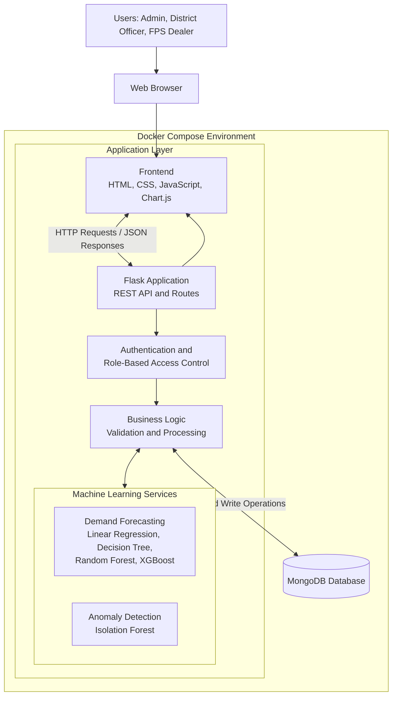

# AI-Powered Smart Public Distribution System (SmartPDS)

An AI-based web application designed to improve Public Distribution System (PDS) operations through demand forecasting, anomaly detection, inventory management and transparent ration distribution.

## 1. Key Features

- **Demand Forecasting:** Predicts monthly food-grain requirements using machine learning.
- **Anomaly Detection:** Uses Isolation Forest to flag unusual transactions for officer review.
- **Inventory Management:** Tracks stock levels, shortages, surplus and procurement requirements.
- **Beneficiary Management:** Maintains ration-card details and calculates PHH and AAY entitlements.
- **Transaction Management:** Records ration distribution and helps prevent duplicate submissions.
- **Dashboard and Reports:** Displays operational information and supports Excel exports.
- **Role-Based Access:** Provides separate access for administrators, district officers and FPS dealers.

## 2. Technology Stack

| Component | Technology |
|---|---|
| Frontend | HTML, CSS, JavaScript, Chart.js |
| Backend | Python, Flask |
| Database | MongoDB |
| Machine Learning | Scikit-learn, XGBoost |
| Data Processing | Pandas, NumPy |
| Testing | Pytest |
| Deployment | Docker, Docker Compose |

## 3. Machine Learning

### Demand Forecasting
- Models: Linear Regression, Decision Tree, Random Forest and XGBoost.
- Uses beneficiary count, commodity, region, historical demand and seasonal information.
- Evaluates models using MAE, MSE, RMSE and R².

### Anomaly Detection
- Algorithm: Isolation Forest.
- Identifies unusual transaction patterns.
- Flags suspicious transactions for manual verification. An anomaly does not automatically confirm fraud.

**Dataset:** Models are trained and evaluated using synthetically generated PDS datasets. Results are experimental and require validation using real distribution data.

## 4. System Architecture

The system follows a three-tier application architecture, with machine learning integrated into the backend.



### Architecture Components

1. **Presentation Layer:** Provides the browser-based interface and dashboards.
2. **Application Layer:** Flask handles API requests, authentication, validation and business operations.
3. **Machine Learning Layer:** Performs demand forecasting and transaction anomaly detection.
4. **Database Layer:** MongoDB stores beneficiaries, commodities, inventory, transactions, predictions and related records.
5. **Deployment Layer:** Docker Compose runs the application and MongoDB in separate containers.

### Data Flow

1. Users access the application through a web browser.
2. The frontend sends requests to Flask REST API endpoints.
3. Flask validates requests and applies role-based permissions.
4. Business logic retrieves or updates records in MongoDB and invokes the required ML services.
5. Forecasts, inventory information and anomaly alerts are returned to the frontend.

## 5. User Roles

- **Administrator:** Manages users, commodities, inventory and system operations.
- **District Officer:** Monitors regional demand, inventory and anomaly alerts.
- **FPS Dealer:** Records ration distribution and checks beneficiary details.

## 6. Installation and Setup

### Prerequisites

Install the following before running the project:

- Git
- Python 3.11
- Docker Desktop
- Docker Compose (included with Docker Desktop)

### Step 1: Clone the Repository

```bash
git clone https://github.com/fawaz165/AI-Powered-Smart-PDS.git
cd AI-Powered-Smart-PDS
```

### Step 2: Configure Environment Variables

Create a `.env` file from the example file.

**Windows PowerShell:**
```powershell
Copy-Item .env.example .env
```

**Linux / macOS:**
```bash
cp .env.example .env
```

Open `.env` and configure the required values. For Docker Compose, the MongoDB connection should use the service hostname:

```env
MONGO_URI=mongodb://mongo:27017/smart_pds_db
SECRET_KEY=replace-with-a-secure-random-value
```

Keep your actual secrets private. Do not commit the `.env` file to GitHub.

### Step 3: Build and Start the Application

Run this command from the project root:

```bash
docker compose up -d --build
```

Docker Compose builds the application image and starts the application and MongoDB containers.

### Step 4: Verify the Containers

```bash
docker compose ps
```

To inspect application logs:

```bash
docker compose logs -f web
```

### Step 5: Open the Application

| Service | URL |
|---|---|
| Application | http://localhost:5000 |
| Health Check | http://localhost:5000/api/health |
| ML Status | http://localhost:5000/api/ml-status |

### Useful Docker Commands

```bash
# Stop containers
docker compose down

# Restart containers
docker compose up -d

# Rebuild after code changes
docker compose up -d --build

# View application logs
docker compose logs -f web
```

**Note:** Avoid `docker compose down -v` unless you intentionally want to remove the associated Docker volumes and their stored database data.

## 7. Testing

Install the backend dependencies:

```bash
pip install -r backend/requirements.txt
```

Run the automated test suite from the project root:

```bash
python -m pytest tests/ -v
```

The documented test run reports **81 passed tests**. Run the test suite again to verify the current code before updating this result.

## 8. Limitations

- Uses synthetic datasets rather than real government distribution records.
- ML predictions require validation using real-world data.
- Anomaly detection identifies unusual patterns, not confirmed fraud.
- Government-system integration is not currently implemented.

## 9. Future Enhancements

- Biometric verification integration.
- IoT-based smart weighing scales.
- GPS-based transportation tracking.
- Integration with government PDS databases.
- Offline transaction support.
