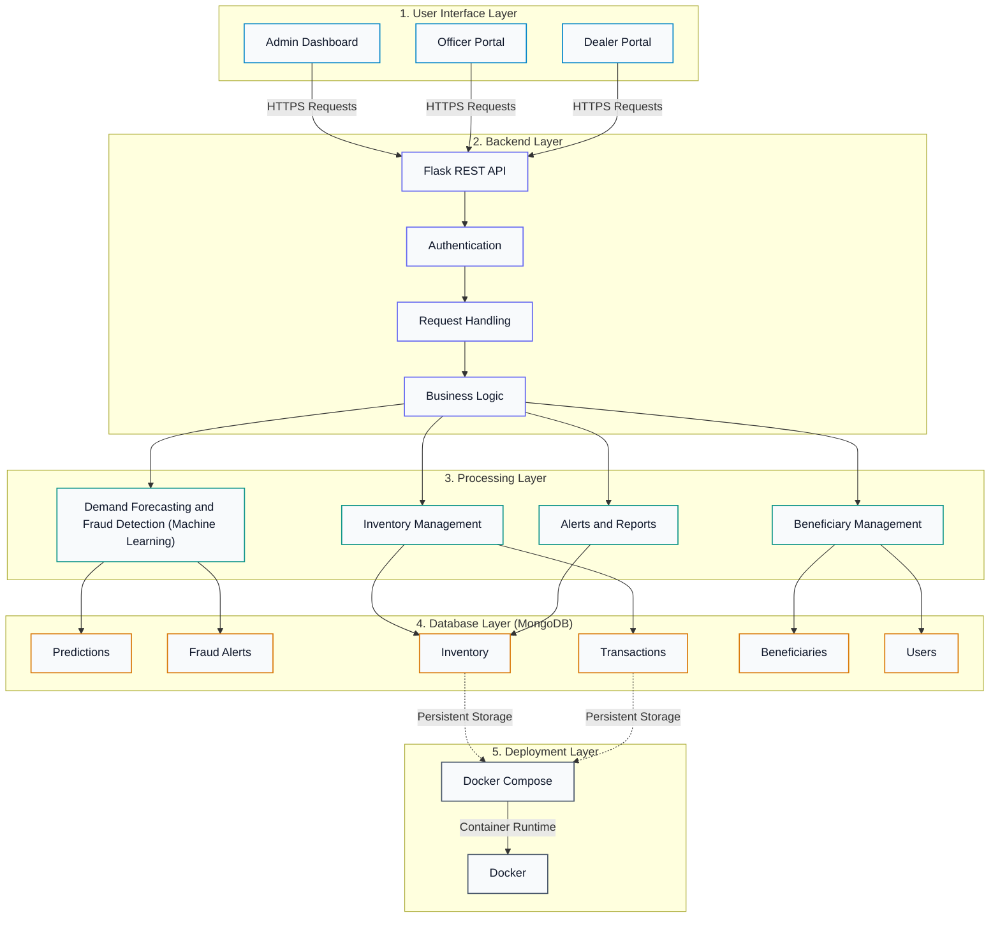
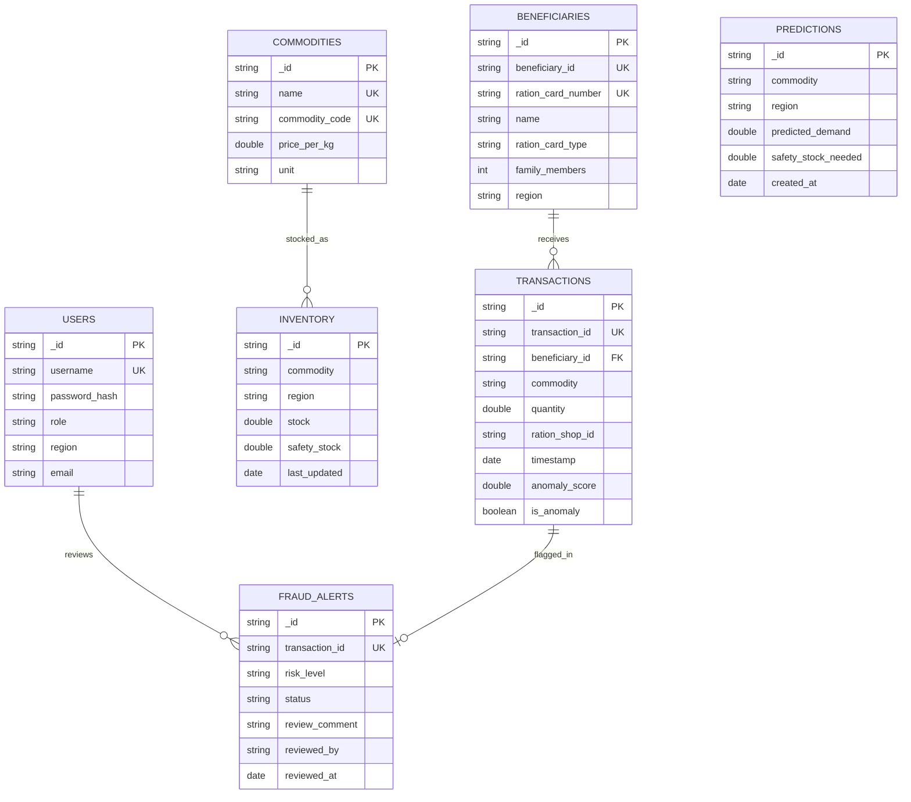

# AI-Powered Smart Public Distribution System (Smart PDS)

[](https://www.python.org/)
[](https://flask.palletsprojects.com/)
[](https://www.mongodb.com/)
[](https://scikit-learn.org/)
[](https://xgboost.readthedocs.io/)
[-brightgreen.svg)](https://pytest.org/)
[](https://www.docker.com/)

---

## 1. Project Title

**AI-Powered Smart Public Distribution System (Smart PDS)**  
*Predictive Allocation Intelligence, Unsupervised Anomaly Detection & Transparent Ration Management*

---

## 2. Project Overview

The **AI-Powered Smart Public Distribution System (Smart PDS)** replaces legacy manual estimation and paper-based record-keeping with an integrated digital workflow. It combines machine learning demand forecasting, unsupervised transaction anomaly detection, thread-safe inventory management, and role-based operational portals.

The platform provides dedicated interfaces for system administrators, district supply officers, and Fair Price Shop (FPS) dealers, ensuring food-grain allocations match demographic requirements while preventing inventory leakage and unauthorized distribution.

---

## 3. Problem Statement

Conventional food-grain distribution networks face significant operational hurdles:

1. **Inaccurate Demand Allocation**: Static allocation formulas fail to account for seasonal variations, festive consumption peaks, and changing cardholder demographics, leading to regional grain shortages or excessive depot stockpiling.
2. **Leakage and Diversion**: Subsidized grains can be diverted away from eligible beneficiaries through bulk withdrawals and irregular transactions.
3. **Manual Verification Bottlenecks**: Auditing millions of monthly transactions manually is infeasible, allowing suspicious distribution patterns to go unnoticed.
4. **Inventory Concurrency Issues**: Legacy record systems struggle with race conditions and overdraws when multiple transactions execute simultaneously against depot stock.
5. **Fragmented Reporting**: Lack of automated, standardized data exports hampers compliance auditing and strategic food security planning.

---

## 4. Project Objectives

- **Predictive Demand Estimation**: Forecast district- and commodity-specific demand using regression models trained on demographic and seasonal historical indicators.
- **Unsupervised Anomaly Detection**: Identify behavioral anomalies in grain collection patterns using Isolation Forest without relying on ground-truth fraud labels.
- **Human-in-the-Loop Governance**: Provide an administrative review console where flagged anomalies are verified by officers before taking action, avoiding automated denial of essential food grain.
- **Thread-Safe Inventory Control**: Ensure zero race conditions and prevent negative stock drawdowns via atomic database-level conditional updates.
- **Role-Based Access Governance**: Restrict operational interfaces and data access using JSON Web Tokens (JWT) and role-based access control (RBAC).
- **Automated Spreadsheet Analytics**: Generate structured Excel reports for stock tracking, distribution ledgers, and audit compliance.

---

## 5. Key Features

- **Multi-Model Demand Forecasting**: Benchmarks Linear Regression, Decision Tree, Random Forest, and XGBoost with month-grouped chronological validation.
- **Feature Ablation Transparency**: Evaluates demand prediction with and without statutory quotas to prevent target leakage and prove true demographic predictive capability.
- **Behavioral Outlier Scoring**: Unsupervised Isolation Forest evaluates withdrawal quantity, quota ratios, inter-transaction intervals, and collection frequency.
- **Administrative Review Workflow**: Complete audit trail (`Pending Review` &rarr; `Verified Legitimate` or `Confirmed Irregularity`) with officer notes and timestamps.
- **Atomic Concurrency Protection**: MongoDB `find_one_and_update` with `{"$gte": quantity}` guards against stock overdraws during concurrent operations.
- **Duplicate Transaction Prevention**: 60-second duplicate submission lock per cardholder and commodity to prevent accidental double-billing.
- **Role-Based Web Dashboards**: Dedicated UI views for System Administrators, District Supply Officers, and FPS Ration Dealers.
- **Automated Excel Export**: Formatted `.xlsx` generation using OpenPyXL with column styling, data filtering, and summary statistics.

---

## 6. System Architecture

The Smart PDS platform is structured as a **5-tier vertically layered architecture**, ensuring clear separation of concerns, high modularity, and reproducible containerized deployments.



### Architectural Layer Breakdown

| Layer | Primary Responsibilities | Codebase Reference |
| :--- | :--- | :--- |
| **1. User Interface** | Responsive portals for System Administrators, District Officers, and FPS Dealers. Built with HTML5, CSS3, and ES6 JavaScript. | `frontend/*.html`, `frontend/js/` |
| **2. Backend Layer** | Central HTTP entrypoint, JWT authentication, RBAC decorators, input validation, and route blueprint dispatching. | `backend/app.py`, `backend/routes/` |
| **3. Processing Layer** | Domain intelligence services: regression forecasting, Isolation Forest anomaly scoring, thread-safe inventory deduction, and reporting. | `backend/services/`, `backend/ml/` |
| **4. Database Layer** | Document datastore managing persistent collections with compound indexing and atomic execution. | `backend/database/mongo.py` |
| **5. Deployment Layer** | Container packaging, persistent volume orchestration, and health probing. | `Dockerfile`, `docker-compose.yml` |

---

## 7. Technology Stack

| Domain | Technology / Library | Version | Description |
| :--- | :--- | :--- | :--- |
| **Programming Language** | Python | `3.11.4` | Core backend runtime environment |
| **Web Framework** | Flask | `3.1.3` | Application server and modular REST API blueprints |
| **WSGI / Security** | Werkzeug | `3.1.4` | HTTP utilities, routing, and password hashing |
| **CORS Handling** | Flask-Cors | `6.0.5` | Cross-Origin Resource Sharing middleware |
| **Database Engine** | MongoDB Server | `6.0+` | NoSQL document datastore |
| **Database Driver** | PyMongo | `4.18.2` | Python MongoDB driver supporting atomic operations |
| **Machine Learning** | Scikit-Learn | `1.9.1` | Regression benchmarks, preprocessing pipelines, and Isolation Forest |
| **Gradient Boosting** | XGBoost | `3.2.0` | Gradient-boosted decision trees for demand regression |
| **Model Serialization** | Joblib | `1.6.0` | Pipeline and trained estimator artifact persistence |
| **Data Manipulation** | Pandas | `3.0.6` | Dataframe manipulation and chronological temporal splitting |
| **Numerical Processing**| NumPy | `>=2.0.0` | Matrix mathematics and array calculations |
| **Spreadsheet Engine** | OpenPyXL | `3.1.5` | Programmatic Excel report generation and formatting |
| **Testing Framework** | Pytest | `9.1.1` | Comprehensive unit and integration test runner |
| **Containerization** | Docker & Docker Compose | Engine `24+` | Container packaging and multi-container orchestration |
| **Frontend Libraries** | Chart.js / FontAwesome | `4.4` / `6.4` | Dynamic charting and responsive iconography |

---

## 8. Project Structure

```
AI-Powered Smart PDS/
├── backend/
│   ├── app.py                      # Flask application factory and blueprint registry
│   ├── config.py                   # Environment configuration and threshold settings
│   ├── requirements.txt            # Python dependencies with pinned versions
│   ├── database/
│   │   ├── mongo.py                # MongoDB singleton wrapper and index initialization
│   │   └── seed_db.py              # Initial database seeder for users, commodities, and stock
│   ├── models/                     # Data schema wrappers (User, Beneficiary, Commodity, etc.)
│   ├── routes/                     # Modular REST API route controllers
│   │   ├── auth_routes.py          # Authentication and profile endpoints
│   │   ├── beneficiary_routes.py   # Ration cardholder registry CRUD
│   │   ├── commodity_routes.py     # Subsidized grain catalog and pricing
│   │   ├── inventory_routes.py     # Depot stock tracking and allocation
│   │   ├── ml_routes.py            # Prediction workbench and anomaly inspection
│   │   ├── report_routes.py        # Dynamic OpenPyXL spreadsheet exports
│   │   └── transaction_routes.py   # Grain distribution and fraud review workflow
│   ├── services/                   # Business logic and processing engines
│   │   ├── auth_service.py         # JWT tokens and role verification decorators
│   │   ├── inventory_service.py    # Thread-safe atomic inventory deductions
│   │   ├── ml_service.py           # ML inference engine and error bound computation
│   │   └── report_service.py       # Excel report generation and styling
│   ├── utils/                      # Logging utilities and input validation helpers
│   └── ml/
│       ├── data/
│       │   ├── generate_pds_data.py # Synthetic TPDS dataset generator
│       │   ├── pds_demand_data.csv  # Synthetic monthly district demand dataset
│       │   └── pds_transactions.csv # Synthetic transaction distribution dataset
│       ├── preprocessing.py         # Feature pipelines and chronological splitting
│       ├── train_demand_model.py    # Demand regression training and ablation benchmarks
│       ├── train_anomaly_model.py   # Unsupervised Isolation Forest training
│       └── saved_models/            # Serialized model pipelines and metrics JSON
├── frontend/
│   ├── index.html                  # Secure authentication portal
│   ├── dashboard.html              # Operational intelligence dashboard
│   ├── beneficiaries.html          # Beneficiary ration card directory
│   ├── commodities.html            # Subsidized food-grain catalog
│   ├── inventory.html              # Depot inventory stock and procurement tracking
│   ├── transactions.html           # Distribution ledger and grain dispatch interface
│   ├── predictions.html            # Machine learning demand forecasting workbench
│   ├── fraud.html                  # Anomaly inspection and administrative review console
│   ├── reports.html                # Analytical spreadsheet export manager
│   ├── about.html                  # System overview and architecture guide
│   ├── css/style.css               # Glassmorphic dark design system
│   └── js/                         # Frontend API clients and view controllers
├── tests/                          # 75 Automated unit and regression test cases
├── .github/workflows/ci-cd.yml     # Automated CI/CD pipeline configuration
├── Dockerfile                      # Hardened container image with non-root user
├── docker-compose.yml              # Multi-container orchestration (Flask + MongoDB 6.0)
├── run.bat                         # One-click Windows Docker Compose launcher
├── run.ps1                         # Windows PowerShell virtual environment runner
├── .dockerignore
├── .gitignore
├── .env.example
└── README.md
```

---

## 9. Machine Learning Modules

> **Dataset Transparency Note**: All datasets (`pds_demand_data.csv` and `pds_transactions.csv`) used for model training and evaluation are **synthetically generated simulation datasets** created by `backend/ml/data/generate_pds_data.py` based on realistic TPDS demographic formulas. They do not contain personally identifiable information (PII) of real citizens.

### 9.1 Demand Forecasting

The demand forecasting module predicts monthly food-grain requirements (in kilograms) across districts and commodities to assist officers in warehouse procurement and buffer stock planning.

- **Chronological Validation**: Data is partitioned using a strict **month-grouped chronological split**. All district and commodity observations for a given calendar month remain entirely within either the training partition or the testing partition, guaranteeing zero temporal data leakage.
- **Input Features (12 Verified Signals)**:
  - *Categorical (2)*: `commodity`, `region` (One-Hot Encoded via `ColumnTransformer`)
  - *Numerical (10)*: `month`, `beneficiary_count`, `avg_family_size`, `previous_month_demand`, `previous_month_offtake`, `historical_average_3m`, `current_stock`, `allocated_quota`, `is_festive_month`, `seasonal_index` (Standard Scaled)

#### Model Benchmark Evaluation

Models were evaluated on out-of-sample chronological test horizons:

| Model | MAE (kg) | MSE | RMSE (kg) | $R^2$ Score | Selection Status |
| :--- | :---: | :---: | :---: | :---: | :--- |
| **Linear Regression** | **370.78** | **309,979.83** | **556.76** | **0.9990** | **Selected Primary Model** |
| **XGBoost Regressor** | 396.17 | 408,795.04 | 639.37 | 0.9986 | Candidate Model |
| **Random Forest** | 434.17 | 484,103.60 | 695.78 | 0.9984 | Candidate Model |
| **Decision Tree** | 556.55 | 872,546.19 | 934.10 | 0.9971 | Candidate Model |

#### Target Leakage & Feature Ablation Analysis

In statutory PDS operations, `allocated_quota` represents a legally mandated entitlement ceiling rather than an unconstrained market indicator. Because actual grain distribution is administratively bound by quota limits, including `allocated_quota` introduces strong target correlation.

To prove that the regressors learn authentic demographic scale rather than merely copying quota caps, an **ablation benchmark** was executed with `allocated_quota` completely removed:

| Model (Without Quota) | MAE (kg) | RMSE (kg) | $R^2$ Score | Key Finding |
| :--- | :---: | :---: | :---: | :--- |
| **Random Forest** | **690.89** | **1,141.20** | **0.9956** | Best non-linear capture of demographic scale |
| **XGBoost Regressor** | 713.40 | 1,173.90 | 0.9954 | Robust gradient-boosted baseline |
| **Linear Regression** | 1,147.59 | 1,636.84 | 0.9910 | Demographic signals account for $>99.1\%$ variance |
| **Decision Tree** | 1,102.35 | 1,999.57 | 0.9866 | Tree depth limits unconstrained generalization |

> **Heuristic Error Bound Clarification**: The system provides forecast margins calculated as $\pm 1.96 \times \text{Test RMSE}$. These bounds represent **empirical error dispersion heuristics** from historical test residuals, rather than mathematically validated parametric confidence intervals.

---

### 9.2 Fraud Detection

The fraud detection module analyzes grain distribution records to detect suspicious behavioral patterns.

- **Algorithm**: Unsupervised **Isolation Forest** (`n_estimators=100`, `contamination=0.05`).
- **Rationale**: Real-world distribution systems lack exhaustive ground-truth fraud labels. Supervised classifiers overfit to known historical schemes and fail against novel diversion tactics. Isolation Forest identifies anomalies through recursive binary splitting without requiring historical fraud labels.
- **Evaluated Transaction Signals (5 Features)**:
  1. `quantity`: Kilograms distributed in the single transaction.
  2. `quantity_to_quota_ratio`: Transaction volume normalized by the cardholder's statutory entitlement.
  3. `days_since_prior_txn`: Inter-collection interval in days.
  4. `monthly_frequency`: Cumulative collection frequency within the calendar month.
  5. `hour`: Transaction timestamp time-of-day indicator.
- **Ethical Human-in-the-Loop Governance**: Transactions identified as mathematical outliers are categorized as **statistical anomalies pending administrative review**. The system **never** automatically labels a citizen as fraudulent or denies grain at the counter. An officer must review the transaction, review justification notes, and formally designate the event as `Verified Legitimate` or `Confirmed Irregularity`.

---

## 10. Database Design

The application uses MongoDB (`smart_pds_db`) with indexed document schemas designed for transactional safety and fast reporting:



### Indexed Collections & Constraints

| Collection | Key Indexed Fields | Index Type | Purpose |
| :--- | :--- | :--- | :--- |
| `users` | `username` (Unique), `email` (Unique Sparse) | B-Tree | Fast credential lookup and duplicate prevention |
| `beneficiaries` | `beneficiary_id` (Unique), `ration_card_number` (Unique), `region` | B-Tree Compound | Rapid card verification and regional filtering |
| `commodities` | `name` (Unique), `commodity_code` (Unique) | B-Tree | Pricing integrity and item catalog management |
| `inventory` | `(commodity, region)` | Compound Unique | Prevents duplicate depot entries; supports atomic stock queries |
| `transactions` | `transaction_id` (Unique), `beneficiary_id`, `timestamp` | Compound B-Tree | Ledger auditing, historical queries, and rate limiting |
| `predictions` | `(commodity, region)`, `created_at` | Compound B-Tree | Time-series forecasting history retrieval |
| `fraud_alerts` | `transaction_id` (Unique), `status`, `risk_level` | Compound B-Tree | Rapid queue filtering for pending administrative reviews |

---

## 11. Application Modules

### 1. Authentication & Role-Based Access Control (RBAC)
- Issues cryptographic JWT tokens signed with server-side secrets.
- Restricts views and endpoints according to three defined operational roles:
  - **System Administrator** (`admin`): Full administrative control over user accounts, commodity catalog pricing, inventory adjustments, and fraud resolution.
  - **District Supply Officer** (`officer`): Jurisdiction-specific oversight of regional inventory depots, demand forecasting workbenches, audit reviews, and report generation.
  - **FPS Ration Dealer** (`dealer`): Distribution ledger entry, cardholder verification, and local shop inventory balance monitoring.

### 2. Operational Intelligence Dashboard
- Aggregates live system metrics: active cardholders, monthly distribution volume, total warehouse stock, and pending anomaly alerts.
- Visualizes real-time distribution velocity and commodity breakdown using Chart.js.

### 3. Beneficiary Registry Management
- Complete CRUD interface for cardholder registration and household management.
- Validates statutory ration card types: **AAY** (Antyodaya Anna Yojana), **PHH** (Priority Household), and **NPHH** (Non-Priority Household).

### 4. Depot Inventory & Concurrency Protection
- Real-time stock balance tracking per district warehouse and commodity.
- Atomic stock decrements execute via `find_one_and_update` with `{"stock": {"$gte": requested_quantity}}`. Requests exceeding warehouse stock are rejected atomically with HTTP `400 Bad Request`.

### 5. Distribution Ledger & Rate Limiting
- Processes ration distributions with instant quota deduction and biometric simulation flags.
- Built-in 60-second duplicate transaction lock prevents inadvertent double-deductions.

### 6. Fraud & Anomaly Audit Console
- Flags transactions whose Isolation Forest anomaly score falls below standard decision thresholds.
- Provides a structured review portal with immutable decision logging, reviewer ID stamps, and audit justifications.

### 7. Analytical Spreadsheet Reporting Engine
- Dynamically compiles database records into formatted Microsoft Excel (`.xlsx`) workbooks using OpenPyXL.
- Provides filtered exports for Inventory Balances, Distribution Transactions, Demand Forecasts, and Fraud Decisions.

---

## 12. Installation and Setup

### Prerequisites
- **Python**: Version `3.11+`
- **MongoDB**: Version `6.0+` active on `localhost:27017`

### Step-by-Step Native Setup

1. **Clone the repository**:
   ```bash
   git clone https://github.com/fawaz165/AI-Powered-Smart-PDS.git
   cd AI-Powered-Smart-PDS
   ```

2. **Configure Python Virtual Environment**:
   ```bash
   # Create virtual environment
   python -m venv .venv

   # Activate virtual environment
   # Windows (Command Prompt):
   .venv\Scripts\activate.bat
   # Windows (PowerShell):
   .\.venv\Scripts\Activate.ps1
   # Linux / macOS:
   source .venv/bin/activate
   ```

3. **Install Dependencies**:
   ```bash
   pip install --upgrade pip
   pip install -r backend/requirements.txt
   ```

4. **Generate Synthetic Datasets and Train ML Models**:
   ```bash
   python backend/ml/data/generate_pds_data.py
   python backend/ml/train_demand_model.py
   python backend/ml/train_anomaly_model.py
   ```

5. **Initialize Database Schema and Seed Data**:
   ```bash
   python backend/database/seed_db.py
   ```
   > *Note: `seed_db.py` creates essential administrative roles, commodity masters, warehouse depots, and sample beneficiaries for testing. In production environments, credentials should be configured using secure environment variables.*

6. **Start Application Server**:
   ```bash
   python backend/app.py
   ```
   Open your browser at **`http://localhost:5000`**.

---

## 13. Docker Deployment

The application includes production-ready container configurations for single-command deployment.

### Container Architecture
- **Web Application Container** (`smart_pds_app`): Python 3.11-slim container running Flask under unprivileged system user `pdsuser` (UID `10001`). Includes an integrated `curl` health probe.
- **Database Container** (`smart_pds_mongo`): Official MongoDB 6.0 container configured with health checks via `mongosh`.
- **Persistent Data Volume** (`mongo_data`): Named Docker volume ensuring database persistence across container restarts.

### Deployment Commands

```bash
# Build and start services in detached mode
docker compose up -d --build

# Verify container status and health
docker compose ps

# Inspect live application logs
docker compose logs -f web

# Stop containers safely (preserves MongoDB data volume)
docker compose stop
```

### One-Click Windows Launchers
- **`run.bat`**: Windows batch launcher that validates Docker Desktop status, launches containers via Docker Compose, polls `/api/health`, and automatically opens the browser.
- **`run.ps1`**: PowerShell runner for native virtual environment execution.

---

## 14. API Documentation

### System & Health Endpoints
| Method | Endpoint | Access | Description |
| :--- | :--- | :--- | :--- |
| `GET` | `/api/health` | Public | Service health verification and version reporting |
| `GET` | `/api/ml-status` | Public | Status check for in-memory demand and anomaly models |

### Authentication & User Management
| Method | Endpoint | Access | Description |
| :--- | :--- | :--- | :--- |
| `POST` | `/api/auth/login` | Public | Authenticates credentials and issues signed JWT |
| `GET` | `/api/auth/me` | Authenticated | Retrieves identity and role details of active token |

### Beneficiary Management
| Method | Endpoint | Access | Description |
| :--- | :--- | :--- | :--- |
| `GET` | `/api/beneficiaries` | Authenticated | Lists cardholders with pagination and regional filtering |
| `POST` | `/api/beneficiaries` | Admin / Officer | Registers a new beneficiary cardholder |
| `GET` | `/api/beneficiaries/<id>` | Authenticated | Retrieves cardholder details and quota balances |
| `PUT` | `/api/beneficiaries/<id>` | Admin / Officer | Updates cardholder information |
| `DELETE`| `/api/beneficiaries/<id>` | Admin | Removes cardholder (blocked if active transactions exist) |

### Commodity Catalog & Pricing
| Method | Endpoint | Access | Description |
| :--- | :--- | :--- | :--- |
| `GET` | `/api/commodities` | Authenticated | Retrieves subsidized grain catalog and prices |
| `POST` | `/api/commodities` | Admin | Registers a new food-grain commodity |
| `PUT` | `/api/commodities/<id>` | Admin | Updates subsidized commodity pricing |

### Inventory & Depot Stock
| Method | Endpoint | Access | Description |
| :--- | :--- | :--- | :--- |
| `GET` | `/api/inventory` | Authenticated | Queries current warehouse stock balances |
| `GET` | `/api/inventory/alerts` | Authenticated | Evaluates depot balances against procurement buffers |
| `PUT` | `/api/inventory/update-stock` | Admin / Officer | Manually adjusts depot stock balances |

### Transactions & Fraud Auditing
| Method | Endpoint | Access | Description |
| :--- | :--- | :--- | :--- |
| `POST` | `/api/transactions` | Dealer / Admin | Processes ration distribution with atomic stock deduction |
| `GET` | `/api/transactions` | Authenticated | Queries transaction ledger with date/shop filters |
| `GET` | `/api/transactions/fraud-alerts` | Officer / Admin | Lists transactions flagged for administrative review |
| `POST` | `/api/transactions/fraud-alerts/<id>/review` | Officer / Admin | Records official audit determination and justification notes |

### Machine Learning & Analytics
| Method | Endpoint | Access | Description |
| :--- | :--- | :--- | :--- |
| `POST` | `/api/predictions/predict` | Authenticated | Generates demand forecast, safety buffer, and error bounds |
| `GET` | `/api/predictions/history` | Authenticated | Retrieves historical saved demand forecasts |
| `GET` | `/api/model-metrics` | Authenticated | Returns evaluation metrics and feature ablation findings |

### Spreadsheet Reports (OpenPyXL)
| Method | Endpoint | Access | Description |
| :--- | :--- | :--- | :--- |
| `GET` | `/api/reports/export/inventory` | Authenticated | Exports formatted Excel inventory depot report (`.xlsx`) |
| `GET` | `/api/reports/export/distribution` | Authenticated | Exports grain distribution ledger report (`.xlsx`) |
| `GET` | `/api/reports/export/predictions` | Authenticated | Exports demand forecast procurement report (`.xlsx`) |
| `GET` | `/api/reports/export/fraud` | Authenticated | Exports fraud audit and review decision report (`.xlsx`) |

---

## 15. Screenshots

The application interface is built with an accessible, high-contrast dark theme optimized for operational workflows:

| Interface View | Description | Suggested Path |
| :--- | :--- | :--- |
| **Operational Intelligence Dashboard** | Real-time overview of distribution volume, stock levels, active cardholders, and quick-action shortcuts. | `docs/screenshots/dashboard.png` |
| **Demand Forecasting Workbench** | Parameterized forecast configuration, multi-commodity shortage calculations, and heuristic error margins. | `docs/screenshots/demand_forecasting.png` |
| **Fraud & Anomaly Review Console** | Outlier transaction queue with risk scoring, behavioral feature breakdown, and officer determination inputs. | `docs/screenshots/fraud_console.png` |
| **Beneficiary Directory** | Cardholder search, entitlement quota status, and household size management. | `docs/screenshots/beneficiaries.png` |
| **Depot Inventory Depots** | Regional stock monitoring, buffer threshold indicators, and stock adjustment dialogs. | `docs/screenshots/inventory.png` |
| **Dynamic Spreadsheet Reports** | Export center for generating and downloading structured OpenPyXL Excel reports. | `docs/screenshots/reports.png` |

---

## 16. Testing and Evaluation

The system includes a 75-test automated test suite covering unit functionality, database concurrency, security guards, and integration lifecycles.

```bash
# Execute the complete automated test suite
python -m pytest tests/ -v
```

### Verified Test Suite Breakdown (75/75 Passed - 100%)

| Test Suite Module | Test Count | Scope & Validation Coverage |
| :--- | :---: | :--- |
| `test_anomaly_detection.py` | 2 | Isolation Forest scoring, outlier separation, feature array formatting |
| `test_auth.py` | 3 | JWT token generation, invalid credential rejection, `/api/auth/me` guard |
| `test_crud_apis.py` | 16 | Beneficiary and commodity catalog CRUD operations, ID auto-generation |
| `test_demand_prediction.py` | 13 | Multi-commodity prediction, shortage calculations, safety stock limits |
| `test_fraud_console_audit.py` | 4 | Human-in-the-loop review workflow, decision status updates |
| `test_full_system_integration.py` | 1 | End-to-end operational lifecycle from registration to distribution |
| `test_health.py` | 2 | `/api/health` connectivity and live MongoDB ping verification |
| `test_inventory_stock.py` | 6 | Overdraw rejection, regional stock filtering, procurement calculations |
| `test_ml_audit_validation.py` | 5 | Month-grouped temporal split verification, zero data leakage checks |
| `test_rbac_and_forecast_history.py` | 3 | Role-based permission enforcement and forecast history persistence |
| `test_reports_and_fraud_audit.py` | 9 | OpenPyXL Excel file generation, MIME headers, and filter validation |
| `test_thread_safe_inventory.py` | 2 | Concurrent multi-threaded stock deduction, negative stock rejection |
| `test_transactions_audit.py` | 9 | 60-second duplicate lock, quota validation, audit trail immutability |

```text
============================= test session starts =============================
platform win32 -- Python 3.11.4, pytest-9.1.1, pluggy-1.6.0
rootdir: D:\AI-Powered Smart PDS
collected 75 items

tests/test_anomaly_detection.py ..                                       [  2%]
tests/test_auth.py ...                                                   [  6%]
tests/test_crud_apis.py ................                                 [ 28%]
tests/test_demand_prediction.py .............                            [ 45%]
tests/test_fraud_console_audit.py ....                                   [ 50%]
tests/test_full_system_integration.py .                                  [ 52%]
tests/test_health.py ..                                                  [ 54%]
tests/test_inventory_stock.py ......                                     [ 62%]
tests/test_ml_audit_validation.py .....                                  [ 69%]
tests/test_rbac_and_forecast_history.py ...                              [ 73%]
tests/test_reports_and_fraud_audit.py .........                          [ 85%]
tests/test_thread_safe_inventory.py ..                                   [ 88%]
tests/test_transactions_audit.py .........                               [100%]

============================= 75 passed in 36.22s =============================
```

---

## 17. Limitations

1. **Synthetic Training Data**: Machine learning models and transaction distributions are currently trained on synthetic simulation datasets. While statistically modeled after TPDS allocation formulas, production real-world deployment requires retraining on verified state civil supplies data.
2. **Statutory Quota Dependency**: In statutory food rationing, legal entitlement ceilings strongly influence total consumption. While the ablation benchmark demonstrates that non-linear models achieve $R^2 \approx 0.995$ without quota features, real-world consumption remains subject to policy shifts and ration card category adjustments.
3. **Unsupervised Outlier Scoring**: Isolation Forest identifies statistical distance from typical patterns. Unsupervised scoring cannot definitively differentiate between fraudulent diversion and legitimate unusual behavior (such as accumulated family ration withdrawals or disaster relief allocations). Administrative human review remains strictly mandatory.
4. **Heuristic Error Intervals**: Prediction error bounds ($\pm 1.96 \times \text{RMSE}$) represent empirical dispersion approximations from historical test residuals rather than formal parametric prediction intervals.

---

## 18. Future Enhancements

- **Biometric e-KYC Integration**: Direct hardware interface with biometric fingerprint and iris scanners at Fair Price Shop Point-of-Sale (PoS) terminals.
- **IoT Smart Weighing Scales**: Integration with digital scales via Bluetooth/serial connections to transmit exact grain weights directly to the transaction ledger, preventing manual entry tampering.
- **State Food Corporation (FCI) ERP Interoperability**: REST API connectors to sync dispatches directly from central Food Corporation of India godowns to state depot warehouses.
- **GPS & Telematics Grain Tracking**: Vehicle tracking integrations to monitor grain transit trucks in real time, detecting unauthorized route diversions between warehouses and fair price shops.
- **Offline Transaction Sync**: Progressive Web App (PWA) offline queuing for rural fair price shops operating in areas with intermittent cellular connectivity.

---

## 19. Contributors

- **Fawaz Ahmed** — *System Architecture, Full-Stack Development, ML Engineering & Deployment* — [GitHub Profile](https://github.com/fawaz165)

---

## 20. License

This project is licensed under the **MIT License**. See the `LICENSE` file for complete terms.
