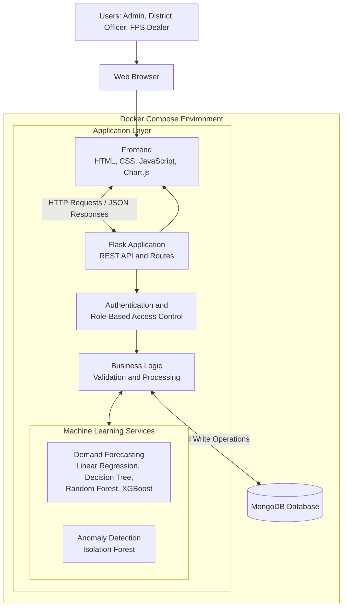

# AI-Powered Smart Public Distribution System (SmartPDS)

An AI-based web application designed to improve Public Distribution System (PDS) operations through demand forecasting, anomaly detection, inventory management and transparent ration distribution.

## 1. Key Features

- **Demand Forecasting:** Predicts monthly food-grain requirements using machine learning.
- **Anomaly Detection:** Uses Isolation Forest to flag unusual transactions for officer review.
- **Inventory Management:** Tracks stock levels, shortages, surplus and procurement requirements.
- **Beneficiary Management:** Maintains ration-card details and calculates PHH and AAY entitlements.
- **Transaction Management:** Records ration distribution and helps prevent duplicate submissions.
- **Dashboard and Reports:** Displays operational information and supports Excel exports.
- **Role-Based Access:** Provides separate access for administrators, district officers and FPS dealers.

## 2. Technology Stack

| Component | Technology |
|---|---|
| Frontend | HTML, CSS, JavaScript, Chart.js |
| Backend | Python, Flask |
| Database | MongoDB |
| Machine Learning | Scikit-learn, XGBoost |
| Data Processing | Pandas, NumPy |
| Testing | Pytest |
| Deployment | Docker, Docker Compose |

## 3. Machine Learning

### Demand Forecasting
- Models: Linear Regression, Decision Tree, Random Forest and XGBoost.
- Uses beneficiary count, commodity, region, historical demand and seasonal information.
- Evaluates models using MAE, MSE, RMSE and R².

### Anomaly Detection
- Algorithm: Isolation Forest.
- Identifies unusual transaction patterns.
- Flags suspicious transactions for manual verification. An anomaly does not automatically confirm fraud.

**Dataset:** Models are trained and evaluated using synthetically generated PDS datasets. Results are experimental and require validation using real distribution data.

## 4. System Architecture

The system follows a three-tier application architecture, with machine learning integrated into the backend.



### Architecture Components

1. **Presentation Layer:** Provides the browser-based interface and dashboards.
2. **Application Layer:** Flask handles API requests, authentication, validation and business operations.
3. **Machine Learning Layer:** Performs demand forecasting and transaction anomaly detection.
4. **Database Layer:** MongoDB stores beneficiaries, commodities, inventory, transactions, predictions and related records.
5. **Deployment Layer:** Docker Compose runs the application and MongoDB in separate containers.

### Data Flow

1. Users access the application through a web browser.
2. The frontend sends requests to Flask REST API endpoints.
3. Flask validates requests and applies role-based permissions.
4. Business logic retrieves or updates records in MongoDB and invokes the required ML services.
5. Forecasts, inventory information and anomaly alerts are returned to the frontend.

## 5. User Roles

- **Administrator:** Manages users, commodities, inventory and system operations.
- **District Officer:** Monitors regional demand, inventory and anomaly alerts.
- **FPS Dealer:** Records ration distribution and checks beneficiary details.

## 6. Installation and Setup

### Prerequisites

Install the following before running the project:

- Git
- Python 3.11
- Docker Desktop
- Docker Compose (included with Docker Desktop)

### Step 1: Clone the Repository

```bash
git clone https://github.com/fawaz165/AI-Powered-Smart-PDS.git
cd AI-Powered-Smart-PDS
```

### Step 2: Configure Environment Variables

Create a `.env` file from the example file.

**Windows PowerShell:**
```powershell
Copy-Item .env.example .env
```

**Linux / macOS:**
```bash
cp .env.example .env
```

Open `.env` and configure the required values. For Docker Compose, the MongoDB connection should use the service hostname:

```env
MONGO_URI=mongodb://mongo:27017/smart_pds_db
SECRET_KEY=replace-with-a-secure-random-value
```

Keep your actual secrets private. Do not commit the `.env` file to GitHub.

### Step 3: Build and Start the Application

Run this command from the project root:

```bash
docker compose up -d --build
```

Docker Compose builds the application image and starts the application and MongoDB containers.

*Quick Windows Launchers:*
- **Docker Compose (Full Stack):** Double-click `run.bat` or run `.\run.bat` in CMD / PowerShell.
- **Native Python (Local App + Docker MongoDB):** Run `.\run.ps1` in PowerShell.

### Step 4: Verify the Containers

```bash
docker compose ps
```

To inspect application logs:

```bash
docker compose logs -f web
```

### Step 5: Initialize the Database (One-Time Setup)

On a fresh installation, run the seed script to create initial commodities, demonstration beneficiaries, and default accounts:

**Docker Compose:**
```bash
docker compose exec web python backend/database/seed_db.py
```

**Local Native Python:**
```bash
python backend/database/seed_db.py
```

*Note: Database seeding is idempotent and does not overwrite existing records.*

### Step 6: Open the Application

| Service | URL |
|---|---|
| Application | http://localhost:5000 |
| Health Check | http://localhost:5000/api/health |
| ML Status | http://localhost:5000/api/ml-status |

#### Demonstration Accounts

| Role | Username | Password | Scope |
|---|---|---|---|
| Administrator | `admin` | `admin123` | System configuration, commodities, and fraud review |
| District Officer | `officer_chennai` | `officer123` | Chennai regional demand, inventory, and transaction audit |
| FPS Dealer | `dealer_001` | `dealer123` | Anna Nagar Fair Price Shop (`FPS-CHN-001`) distribution |

### Useful Docker Commands

```bash
# Stop containers safely (preserves MongoDB data volume)
docker compose stop

# Stop containers and remove network (preserves data volume)
docker compose down

# Restart containers
docker compose up -d

# Rebuild after code changes
docker compose up -d --build

# View application logs
docker compose logs -f web
```

**Note:** Avoid `docker compose down -v` unless you intentionally want to delete the persistent MongoDB data volume.

## 7. Testing

The automated test suite runs against an isolated test database (`smart_pds_test_db`) without modifying demonstration or production data.

Install the backend dependencies:

```bash
pip install -r backend/requirements.txt
```

Run the automated test suite from the project root:

**Windows PowerShell:**
```powershell
$env:MONGO_URI="mongodb://localhost:27017/smart_pds_test_db"; python -m pytest tests/ -v
```

**Linux / macOS:**
```bash
MONGO_URI="mongodb://localhost:27017/smart_pds_test_db" python -m pytest tests/ -v
```

The automated test suite reports **89 passed tests (100% pass rate)**.

## 8. Troubleshooting

- **Automatic Port Conflict Resolution:** The launcher scripts (`run.bat` and `run.ps1`) automatically detect if application port 5000 or MongoDB host port 27018 are in use by other applications, automatically selecting the next available ports (e.g. 5001, 27019) and keeping container routing, health checks, and browser URLs in sync without manual configuration.
- **Manual Host Port Customization:** You can explicitly set `PORT=5001` and `MONGO_PORT_BINDING=127.0.0.1:27019` in your `.env` file if specific fixed ports are desired.
- **MongoDB Connection Error:** Ensure Docker Desktop is active and MongoDB has passed its health check (`docker compose ps`).
- **Database Initialization:** If login fails with "Invalid username or password" on a fresh install, run the database seed command (`docker compose exec web python backend/database/seed_db.py`).

## 9. Limitations

- Uses synthetic datasets rather than real government distribution records.
- ML predictions require validation using real-world data.
- Anomaly detection identifies unusual patterns, not confirmed fraud.
- Government-system integration is not currently implemented.

## 10. Future Enhancements

- Biometric verification integration.
- IoT-based smart weighing scales.
- GPS-based transportation tracking.
- Integration with government PDS databases.
- Offline transaction support.
